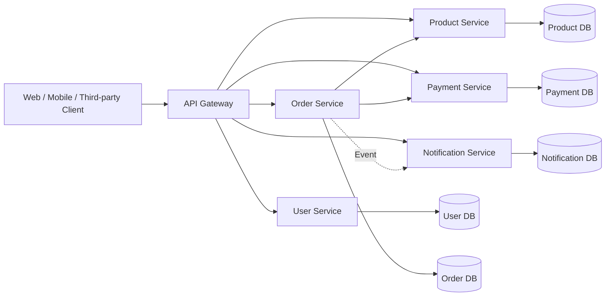
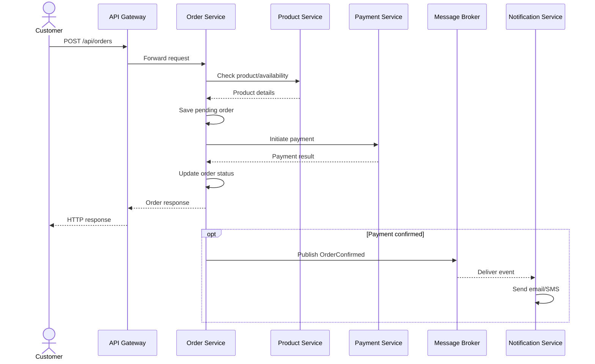

# Microservices Architecture & Advantages — Detailed Student Notes

**Audience:** Beginners learning Java, Spring Boot, and distributed systems  
**Goal:** Understand the architecture shown in the reference diagram, what each component does, how a request flows, why teams adopt microservices, and the trade-offs.

---

## 1. What are microservices?

Microservices architecture divides an application into multiple **small, independently deployable services**, each focused on a business capability. Services communicate over network interfaces such as HTTP/REST or through asynchronous messages/events.

**Example: E-commerce platform**

- **User Service:** customer registration, profile, account management.
- **Product Service:** product catalog, product information, prices.
- **Order Service:** create orders and track order status.
- **Payment Service:** initiate and track payments.
- **Notification Service:** send email/SMS/push notifications.

Each service can have its own codebase, deployment lifecycle, data ownership, and scaling rules. A microservice does **not** have to be tiny; the important idea is a clear business responsibility and independent evolution.

### Monolith vs microservices

| Aspect | Monolith | Microservices |
|---|---|---|
| Code organization | One deployable application | Multiple independently deployable applications |
| Deployment | Deploy the application together | Deploy services separately |
| Scaling | Often scale the whole application | Scale busy services independently |
| Communication | Mostly in-process calls | Network calls and/or messaging |
| Data | Often one shared database | Prefer data ownership per service |
| Operations | Simpler to start | More distributed-systems complexity |
| Best fit | Small teams, straightforward domains | Larger or evolving systems with clear domain boundaries |

> **Important:** Microservices are not automatically better. A well-designed monolith is often the best starting point for a small application.

---

## 2. High-level architecture from the image

The diagram contains **Clients → API Gateway → Microservices → Service-owned Databases**, plus supporting infrastructure.



**Reading the diagram:** Arrows represent potential communication, not a rule that every service must directly call every other service. Real designs should minimize unnecessary coupling.

### Why use an API Gateway?

A gateway is the public entry point for clients and can:

1. **Route requests**: `/api/users/**` → User Service; `/api/orders/**` → Order Service.
2. **Authenticate requests** or integrate with an identity provider.
3. **Apply rate limits** to protect downstream services.
4. **Enforce cross-cutting policies** such as CORS, request-size limits, and some security checks.
5. **Observe traffic** through logging and metrics.
6. **Load balance** across available instances, when configured.

The gateway **should not contain core order, payment, or product business logic**. It is also not a substitute for authorization checks inside services.

**Spring ecosystem example:** Spring Cloud Gateway. An API Gateway is useful but not mandatory for every microservices system.

---

## 3. Understand each business service

### 3.1 User Service

**Responsibility:** manage user profiles and customer accounts.

Possible APIs:

```http
POST /api/users
GET /api/users/101
PUT /api/users/101
DELETE /api/users/101
```

Example response:

```json
{"id":101,"name":"Ravi","email":"ravi@example.com"}
```

**Owns:** user-related data. Avoid allowing other services to query its database tables directly.

### 3.2 Product Service

**Responsibility:** product catalog and product information. Inventory availability can be part of this service in a simple demo, but a larger system may use a separate Inventory Service.

```http
GET /api/products/501
```

```json
{"id":501,"name":"Laptop","price":55000.00,"available":true}
```

### 3.3 Order Service

**Responsibility:** order lifecycle: creating orders, storing line items, and tracking order states.

```http
POST /api/orders
GET /api/orders/9001
```

Order states might be `CREATED`, `PENDING_PAYMENT`, `CONFIRMED`, `CANCELLED`, or `FAILED`.

**Key point:** Order Service may need product information and payment status, but it should not directly read Product DB or Payment DB.

### 3.4 Payment Service

**Responsibility:** payment initiation, provider integration, payment status, refunds.

```http
POST /api/payments
GET /api/payments/7001
```

**Production consideration:** Never store raw card data casually. Use a trusted payment provider and follow relevant security/compliance requirements. Use **idempotency keys** to prevent duplicate charges when requests are retried.

### 3.5 Notification Service

**Responsibility:** email, SMS, and push notifications.

Example: consume an `OrderConfirmed` event and send a confirmation email. Sending notifications asynchronously often avoids delaying the order API response.

---

## 4. Complete request flow: placing an order

Consider a customer ordering one laptop.

1. **Client** sends `POST /api/orders` to the API Gateway.
2. **Gateway** applies its configured policies and routes the request to Order Service.
3. **Order Service** validates the request and checks product details/availability through Product Service (or Inventory Service).
4. **Order Service** records the order with an appropriate initial state in Order DB.
5. **Payment Service** processes or initiates payment through a provider.
6. **Order Service** updates the order status based on the reliable payment result.
7. **OrderConfirmed event** is published after confirmation.
8. **Notification Service** consumes the event and sends a message.
9. **Client** receives an order result or an accepted/pending response, depending on whether the workflow is synchronous or asynchronous.



**Teaching note:** This is a simplified learning flow. Production payment workflows often use asynchronous provider callbacks/webhooks, retries, reconciliation, transactional outbox patterns, and sagas for consistency across services.

---

## 5. Database per service

The diagram shows a separate database for User, Order, Product, Payment, and Notification services.

### What does “database per service” mean?

Each service **owns its data**. Other services interact through the owner's API or published events, not by querying its tables directly.

| Service | Example tables |
|---|---|
| User | `users`, `addresses` |
| Product | `products`, `categories` |
| Order | `orders`, `order_items` |
| Payment | `payments`, `refunds` |
| Notification | `notification_log`, `templates` |

This can mean separate database servers, separate logical databases, or separate schemas with enforced access boundaries. Physical separation is not always necessary.

### Advantages

- Clear ownership and less accidental coupling.
- Each service can evolve its schema independently.
- Service-specific data storage technology is possible.
- Independent tuning, backups, and access controls are easier to organize.

### Challenges

- Cross-service SQL joins are no longer straightforward.
- Transactions spanning multiple services become complex.
- Data can be temporarily inconsistent.
- Reporting may require read models, events, or data pipelines.

**Example:** Order Service stores `customerId` rather than depending on a cross-database foreign key into User Service.

**Important:** Avoid a shared database schema accessed directly by all services if independent ownership is the goal.

---

## 6. Inter-service communication

### 6.1 Synchronous communication (HTTP/REST)

One service sends a request and waits for a response.

```text
Order Service → Product Service → Product data returned
```

In Spring Boot, common clients include **RestClient**, **WebClient**, and **Spring Cloud OpenFeign**.

**Benefits:** simple request/response semantics; useful when an immediate answer is needed.

**Risks:** latency, timeouts, and cascading failures if downstream services are unavailable.

### 6.2 Asynchronous communication (messaging/events)

A service publishes an event to a broker, and another service consumes it later.

```text
Order Service → OrderConfirmed event → Kafka/RabbitMQ → Notification Service
```

**Benefits:** reduced temporal coupling, buffering of workloads, and better handling of background processing.

**Risks:** eventual consistency, duplicate delivery, ordering concerns, schema evolution, and debugging complexity.

| Decision | Prefer synchronous | Prefer asynchronous |
|---|---|---|
| Need an immediate result? | Yes | Usually no |
| Work can happen later? | Possible | Often ideal |
| Examples | Fetch product price | Send confirmation email |
| Main concern | Availability/latency | Delivery/ordering/idempotency |

---

## 7. Supporting infrastructure shown in the image

These are **options**, not mandatory parts of every microservices architecture.

### 7.1 Service Discovery — Eureka / Consul

**Problem:** Service instances may run at changing addresses or ports.

**Solution:** Discovery helps a client or routing layer find healthy instances by service name.

```text
Order Service → lookup product-service → select instance → send request
```

**When useful:** dynamic service environments. In Kubernetes, built-in Services and DNS commonly provide discovery, so Eureka may not be necessary.

### 7.2 Centralized Configuration — Spring Cloud Config

**Problem:** many services need environment-specific configuration.

**Solution:** centralize and version configuration with appropriate security controls.

Examples: downstream URLs, feature flags, timeouts, non-secret configuration.

**Security:** secrets should be protected through a suitable secret-management system, not casually committed in plain text.

**Alternative:** environment variables, Kubernetes ConfigMaps and Secrets, managed cloud configuration.

### 7.3 Message Broker — Kafka / RabbitMQ

A message broker transports messages or events between producers and consumers.

- **Kafka:** distributed event streaming, replayable event logs, consumer groups.
- **RabbitMQ:** message queues and routing patterns for task/work distribution.

They are not identical technologies; choose based on delivery, ordering, retention, throughput, and operational needs.

### 7.4 Distributed Tracing — Sleuth / Zipkin (diagram labels)

A single client request may cross several services. Tracing correlates spans to show where time is spent and where failures occur.

```text
Gateway → Order → Product → Payment
  Trace ID shared across the request chain
```

**Modern Spring Boot note:** Spring Cloud Sleuth was used with older Spring Boot generations. For Spring Boot 3+, commonly use **Micrometer Tracing** with an OpenTelemetry or Brave bridge and a backend such as Zipkin or Jaeger.

### 7.5 Monitoring & Metrics — Prometheus / Grafana

- **Metrics:** request counts, error rates, response latency, JVM memory, CPU, queue depth.
- **Prometheus:** collects and queries time-series metrics.
- **Grafana:** builds dashboards and visualizations.

For Spring Boot, Actuator and Micrometer are common building blocks.

**Three observability signals:** metrics, logs, and traces. They answer different questions and work best together.

---

## 8. Advantages of microservices — explained with examples

### 8.1 Scalability

**Meaning:** scale individual services according to demand.

**Example:** During a shopping sale, Product Service receives far more traffic than User Service. Deploy additional Product Service instances without necessarily increasing all other services.

**Caution:** the database and dependencies must also handle the extra load; scaling an API alone may not solve a bottleneck.

### 8.2 Independent deployment

**Meaning:** release one service without rebuilding and deploying the entire system.

**Example:** Add a new notification template and deploy Notification Service independently.

**Caution:** backward-compatible API and event contracts are needed so existing consumers keep working.

### 8.3 Technology flexibility

**Meaning:** different services may use different languages or data stores.

**Example:** User Service uses Spring Boot/PostgreSQL while an analytics service uses Python.

**Caution:** too many technologies increase maintenance, hiring, security, and operational costs. Standardize unless variation provides real value.

### 8.4 Better fault isolation

**Meaning:** one service failure need not crash the entire application.

**Example:** Notification Service is unavailable, but a confirmed order remains valid and notification delivery can retry later.

**Caution:** this requires deliberate isolation, timeouts, queues, fallbacks, and capacity planning. Microservices do not provide fault isolation automatically.

### 8.5 Maintainability

**Meaning:** clear service boundaries can make each business area easier to understand.

**Example:** Developers changing payment rules can focus on Payment Service.

**Caution:** poorly chosen boundaries create excessive cross-service calls and distributed complexity.

### 8.6 Team autonomy

**Meaning:** teams can own services end-to-end.

**Example:** The Orders team owns its API, code, tests, database migrations, dashboards, and deployments.

**Caution:** teams still need shared API standards, security policies, and platform support.

### 8.7 Resilience and high availability

**Meaning:** services can be designed to continue operating despite failures.

**Tools and patterns:** retries with backoff, circuit breakers, timeouts, bulkheads, load balancing, redundant instances, graceful degradation.

**Caution:** retries are unsafe for some operations unless they are idempotent. Never blindly retry payment creation.

### 8.8 Cloud deployment

**Meaning:** independently deployable services can fit container and cloud orchestration platforms.

**Examples:** Docker images, Kubernetes workloads, managed container services.

**Caution:** microservices do not require Kubernetes or containers. You can run separate Spring Boot JARs on VMs or servers.

### 8.9 Faster time to market

**Meaning:** teams can ship features independently and shorten release cycles.

**Example:** The Product team releases catalog improvements without waiting for unrelated notification changes.

**Caution:** benefits depend on automated testing, CI/CD, clear ownership, and stable contracts; otherwise coordination can become slower.

---

## 9. Important disadvantages and challenges

The image emphasizes advantages, but students should understand the costs too.

1. **Distributed-system complexity:** networks fail, messages get delayed, and remote calls time out.
2. **Operational overhead:** multiple applications to deploy, configure, monitor, and secure.
3. **Data consistency:** no simple single transaction across all independent databases.
4. **Debugging difficulty:** one business operation can span many services.
5. **Network latency:** remote calls are slower and less reliable than in-process calls.
6. **Testing complexity:** contract, integration, end-to-end, and failure testing matter.
7. **Versioning:** APIs and events must evolve without breaking consumers.
8. **Infrastructure cost:** more processes, pipelines, logging, and monitoring.
9. **Security:** service-to-service authentication, authorization, secrets, and network policies.

**Practical rule:** Choose microservices when the expected organizational and scaling benefits justify these costs.

---

## 10. Core design patterns to learn

| Pattern | Problem solved | Simple example |
|---|---|---|
| API Gateway | One client entry point | Route `/api/orders` to Order Service |
| Database per Service | Independent data ownership | Order DB belongs to Order Service |
| Circuit Breaker | Prevent repeated calls to a failing dependency | Stop calling an unhealthy Product Service temporarily |
| Retry with Backoff | Recover from transient failures | Retry a safe read after a timeout |
| Bulkhead | Limit failure spread | Separate connection pools for dependencies |
| Saga | Coordinate multi-service business transactions | Order/payment/reservation workflow |
| Transactional Outbox | Reliably publish events with DB state changes | Persist order and outbox event in one DB transaction |
| Idempotent Consumer | Handle duplicate event delivery safely | Process `OrderConfirmed` only once logically |
| CQRS | Separate read/write models where useful | Optimized order search read model |
| Strangler Fig | Gradually migrate a monolith | Extract notification functionality first |

### Circuit breaker states

- **Closed:** requests flow normally while failures are measured.
- **Open:** requests fail fast or use a fallback for a period.
- **Half-open:** a limited number of trial requests test recovery.

**Spring Boot option:** Resilience4j integrates with Spring Boot for circuit breakers, retries, and related resilience patterns.

---

## 11. Example Spring Boot microservices project structure

For a student project, use **separate Spring Boot applications**, not necessarily a multi-module build.

```text
microservices-demo/
├── api-gateway/
├── user-service/
├── product-service/
├── order-service/
├── payment-service/
└── notification-service/
```

Each service might contain:

```text
order-service/
├── pom.xml
└── src/main/
    ├── java/com/javacodeex/order/
    │   ├── controller/
    │   ├── service/
    │   ├── repository/
    │   ├── entity/
    │   ├── dto/
    │   ├── client/
    │   ├── exception/
    │   └── OrderServiceApplication.java
    └── resources/application.yml
```

### Example local port allocation

| Application | Port | Data store |
|---|---:|---|
| API Gateway | 8080 | None required |
| User Service | 8081 | `user_db` |
| Product Service | 8082 | `product_db` |
| Order Service | 8083 | `order_db` |
| Payment Service | 8084 | `payment_db` |
| Notification Service | 8085 | Optional `notification_db` |

These are **illustrative development ports**, not required defaults.

### Example Order Service controller

```java
@RestController
@RequestMapping("/api/orders")
public class OrderController {
    private final OrderService orderService;

    public OrderController(OrderService orderService) {
        this.orderService = orderService;
    }

    @PostMapping
    public ResponseEntity<OrderResponse> create(
            @Valid @RequestBody CreateOrderRequest request) {
        OrderResponse response = orderService.createOrder(request);
        return ResponseEntity.status(HttpStatus.CREATED).body(response);
    }
}
```

This snippet demonstrates the **controller layer only**. `OrderService`, `CreateOrderRequest`, and `OrderResponse` are application-specific types that students must implement; imports and validation rules are omitted for clarity.

### Example product lookup using Spring RestClient

```java
@Service
public class ProductClient {
    private final RestClient restClient;

    public ProductClient(RestClient.Builder builder) {
        this.restClient = builder
            .baseUrl("http://localhost:8082")
            .build();
    }

    public ProductResponse getProduct(Long productId) {
        return restClient.get()
            .uri("/api/products/{id}", productId)
            .retrieve()
            .body(ProductResponse.class);
    }
}
```

Here `ProductResponse` is a DTO students define. For production, configure URLs externally and apply sensible timeouts, error handling, and resilience policies. A discovery-enabled load-balanced client or OpenFeign is another option.

---

## 12. Service design best practices

1. **Split by business capability**, not by technical layer. Do not create a single global Controller Service and Repository Service.
2. **Keep each service's data private** behind its contract.
3. **Prefer explicit, versioned API/event contracts** and backward-compatible changes.
4. **Set timeouts** for outbound network calls; avoid unbounded waiting.
5. **Use retries selectively**, with backoff and idempotency safeguards.
6. **Avoid long synchronous chains** where one request depends on many downstream services.
7. **Publish domain events** for suitable background workflows.
8. **Protect endpoints and service communication** with authentication, authorization, TLS, and secret management.
9. **Add health checks, metrics, logs, and tracing** appropriate to the environment.
10. **Automate tests and deployment**; use contract tests for service interfaces.
11. **Plan for failure**, including unavailable services, duplicate messages, and partial success.
12. **Start simple**; add service discovery, configuration servers, brokers, and orchestration only when justified.

---

## 13. Student hands-on assignment

### Assignment: Mini E-commerce Microservices System

**Goal:** Build and run three independent Spring Boot services and an optional API Gateway.

**Minimum services:**

- **Product Service:** create/list products; `GET /api/products/{id}`.
- **Order Service:** create an order after checking product availability through HTTP.
- **Notification Service:** log or simulate an order confirmation; optionally consume an event from a broker.

**Requirements:**

- Java 21, Spring Boot 3, Maven, PostgreSQL.
- Layered structure: Controller → Service → Repository.
- DTOs, Bean Validation, global exception handling.
- Separate databases for Product and Order services.
- HTTP communication using RestClient or OpenFeign.
- JSON APIs; document endpoints with OpenAPI/Swagger.
- Unit tests and at least one integration test.
- Run services independently and verify with Postman/curl.

**Stretch tasks:** Add API Gateway, Resilience4j circuit breaker, message broker, and monitoring—one feature at a time.

### Suggested test cases

| Test | Expected behavior |
|---|---|
| Fetch existing product | 200 with product JSON |
| Fetch missing product | 404 from Product Service |
| Create order with valid product | Order saved with appropriate status |
| Create order with invalid product | Clear validation or domain error |
| Product Service unavailable | Order Service times out/fails gracefully; no false success |
| Repeat a payment or event | No duplicate business action when idempotency is implemented |
| Notification Service unavailable | Order can remain valid; notification is retried when designed asynchronously |

---

## 14. Interview questions and short answers

**Q1. What is microservices architecture?**  
A system design where business capabilities are implemented as independently deployable services that communicate through APIs or messaging.

**Q2. Why use an API Gateway?**  
To provide centralized routing and common edge policies for client requests.

**Q3. What is database per service?**  
Each service owns its data and other services access it through contracts rather than direct table access.

**Q4. How do microservices communicate?**  
Synchronously via HTTP/gRPC or asynchronously through messaging and events.

**Q5. What is service discovery?**  
A mechanism for finding service instances without hardcoding their changing addresses.

**Q6. What is a circuit breaker?**  
A resilience pattern that temporarily blocks calls to a failing dependency to prevent repeated failures and resource exhaustion.

**Q7. What is eventual consistency?**  
Different services may temporarily hold different views of data before updates propagate.

**Q8. What is a Saga?**  
A sequence of local transactions coordinated through events or commands, with compensating actions when steps fail.

**Q9. Is Kafka mandatory?**  
No. Simple microservices can communicate over HTTP; add messaging when its benefits justify the complexity.

**Q10. Is Eureka mandatory?**  
No. Fixed development URLs, DNS, Kubernetes Services, or other discovery mechanisms may be sufficient.

**Q11. Can microservices use different languages?**  
Yes, provided they maintain compatible contracts and operational standards.

**Q12. Does microservices architecture guarantee high availability?**  
No. High availability requires replication, failure handling, health checks, infrastructure, and operational discipline.

**Q13. Why are distributed transactions challenging?**  
Services own separate data stores, so one local database transaction cannot automatically atomically update all services.

**Q14. What is distributed tracing?**  
Tracking a request across multiple services using correlated traces and spans.

**Q15. When should a team avoid microservices?**  
When the domain is simple, team capacity is limited, operational maturity is low, or a modular monolith meets the requirements.

---

## 15. Final revision / key takeaways

- **Clients** call APIs, often through an **API Gateway**.
- **Business services** focus on capabilities such as Users, Orders, Products, Payments, and Notifications.
- **Database per service** means clear ownership, not necessarily a separate physical server for every database.
- **HTTP** supports immediate request/response; **messaging** supports asynchronous workflows.
- **Discovery, centralized config, brokers, tracing, and metrics** are supporting options, not universal requirements.
- **Main advantages:** independent deployment, targeted scaling, ownership, maintainability, and the potential for better resilience and release speed.
- **Main costs:** network failures, eventual consistency, operational overhead, security, and testing complexity.
- **Best principle:** start with clear domain boundaries and add distributed complexity only where it delivers measurable value.

**One-line summary:** *Microservices divide a system by business capability so teams can build, deploy, and scale services independently—while accepting the added responsibility of managing distributed-system complexity.*
