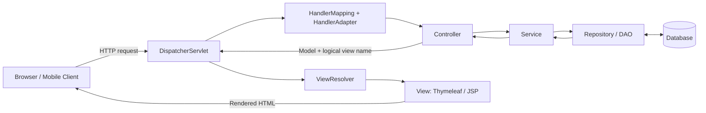
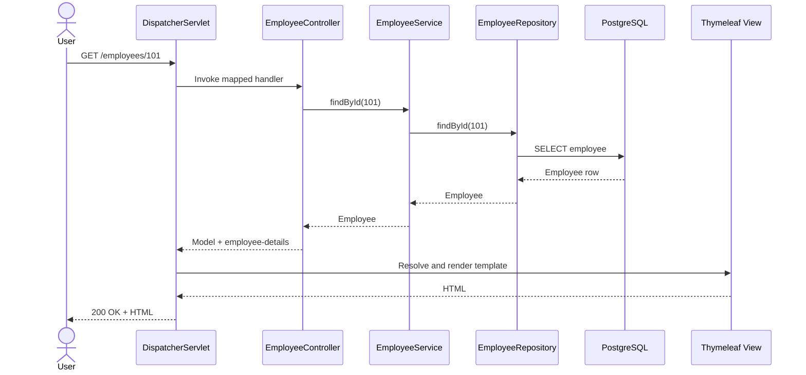

# Spring MVC Web Application — Detailed Student Notes

## 1. What is Spring MVC?

**Spring MVC** is the Servlet-based web framework in the Spring ecosystem. MVC stands for **Model–View–Controller**, a pattern that separates application data, request handling, and presentation.

A user opens a URL such as `http://localhost:8080/employees/101`. The browser sends an HTTP request. Spring MVC selects the correct controller method, the application retrieves data, and Spring produces an HTTP response (HTML, JSON, etc.).

**Important distinction:** Spring Framework supplies Spring MVC; **Spring Boot** simplifies setting up and running Spring applications using auto-configuration and embedded servers. Spring MVC works both with and without Spring Boot.

### MVC responsibilities

| Part | Responsibility | Typical Spring example |
|---|---|---|
| Model | Application state/data passed to a view; domain model may include business rules | `Employee`, `Model` attributes |
| View | Presents data to the user | Thymeleaf template, JSP |
| Controller | Handles incoming web requests and coordinates work | `@Controller` |
| Service *(additional application layer)* | Holds business use cases and rules | `@Service` |
| Repository *(additional application layer)* | Reads/writes persistent data | `@Repository`, Spring Data JPA |

> Service and Repository are not the three letters of MVC, but are common layers in maintainable Spring MVC applications.

---

## 2. Big-picture architecture



This diagram represents the **server-rendered MVC** case. REST controllers often skip view resolution and instead serialize response objects to JSON.

### Example scenario

A student clicks **View Employee** for employee `101`:

1. Browser requests `GET /employees/101`.
2. `DispatcherServlet` receives the request.
3. Spring locates the controller handler mapped to that URL and HTTP method.
4. Controller calls `EmployeeService`.
5. Service calls `EmployeeRepository`.
6. Repository queries the database.
7. Data returns through repository → service → controller.
8. Controller places employee data in a `Model` and returns logical view name `employee-details`.
9. A view resolver identifies the Thymeleaf template.
10. Thymeleaf renders HTML using model attributes.
11. Spring sends an HTTP response; browser displays the page.

**Nuance:** The diagram is conceptual. Spring MVC also uses a **HandlerAdapter** to invoke a selected handler, and `DispatcherServlet` orchestrates view rendering. A `ModelAndView` is one possible return type; controllers may instead return a `String` view name and accept a `Model` argument.

---

## 3. DispatcherServlet — Front Controller

`DispatcherServlet` is the central entry point for Spring MVC requests. It implements the **Front Controller design pattern**: one central servlet coordinates request handling rather than every endpoint being a separately configured servlet.

**Key tasks:**

- Receive incoming HTTP requests.
- Consult handler mappings to locate the appropriate handler.
- Use a handler adapter to invoke the handler method.
- Coordinate exception resolution and other MVC infrastructure.
- Resolve and render a view for server-rendered responses.
- Write the final HTTP response.

**Example:** `GET /employees/101` reaches `DispatcherServlet`, which finds the `@GetMapping("/{id}")` handler in the appropriate controller.

**Interview answer:** `DispatcherServlet` is Spring MVC's front controller that coordinates request routing, handler invocation, and response rendering.

---

## 4. HandlerMapping and HandlerAdapter

### HandlerMapping

A **HandlerMapping** determines which controller handler should process a request. It considers mappings such as request path, HTTP method, and sometimes headers, parameters, and media types.

```java
@GetMapping("/employees/{id}")
public String showEmployee(@PathVariable Long id, Model model) {
    // ...
    return "employee-details";
}
```

For `GET /employees/101`, Spring extracts `id = 101` and selects the matching handler.

### HandlerAdapter

A **HandlerAdapter** invokes the selected handler in a form supported by Spring MVC. It also supports method arguments such as `@PathVariable`, `@RequestParam`, and `Model`, and helps process the method's return value.

> HandlerMapping **finds** the handler; HandlerAdapter **invokes** it.

---

## 5. Controller layer

The controller handles HTTP-specific concerns and delegates business work to the service.

```java
@Controller
@RequestMapping("/employees")
public class EmployeeController {

    private final EmployeeService employeeService;

    public EmployeeController(EmployeeService employeeService) {
        this.employeeService = employeeService;
    }

    @GetMapping("/{id}")
    public String details(@PathVariable Long id, Model model) {
        Employee employee = employeeService.findById(id);
        model.addAttribute("employee", employee);
        return "employee-details";
    }
}
```

**Annotations explained:**

- `@Controller`: registers a Spring MVC controller bean.
- `@RequestMapping`: establishes a common path prefix.
- `@GetMapping`: maps HTTP GET requests.
- `@PathVariable`: binds a segment of the URL to a method parameter.
- `Model`: carries named data attributes to the view.

**Best practice:** Avoid putting SQL queries, complex validations, and business rules directly in controller methods.

---

## 6. Service layer — business logic

A service represents a business use case, for example **find employee by ID**, **calculate salary**, or **approve leave**.

```java
@Service
public class EmployeeService {

    private final EmployeeRepository repository;

    public EmployeeService(EmployeeRepository repository) {
        this.repository = repository;
    }

    public Employee findById(Long id) {
        return repository.findById(id)
            .orElseThrow(() -> new EmployeeNotFoundException(id));
    }
}
```

**Why a service layer?** Business rules can be reused by MVC controllers, REST controllers, scheduled jobs, or other entry points. Services are also easier to unit-test in isolation.

---

## 7. Repository / DAO and database

A repository abstracts persistence operations. A common implementation uses **Spring Data JPA**, backed by a JPA provider such as Hibernate.

```java
public interface EmployeeRepository
        extends JpaRepository<Employee, Long> {
}
```

Spring Data JPA can provide CRUD implementations automatically. Typical operations include `save`, `findById`, `findAll`, and `deleteById`.

### Employee entity

```java
import jakarta.persistence.Entity;
import jakarta.persistence.GeneratedValue;
import jakarta.persistence.GenerationType;
import jakarta.persistence.Id;

@Entity
public class Employee {
    @Id
    @GeneratedValue(strategy = GenerationType.IDENTITY)
    private Long id;
    private String name;
    private double salary;

    protected Employee() { } // Required by JPA

    public Employee(String name, double salary) {
        this.name = name;
        this.salary = salary;
    }

    public Long getId() { return id; }
    public String getName() { return name; }
    public double getSalary() { return salary; }
}
```

For a training demo, `double` is easy to understand. In financial production systems, prefer `BigDecimal` for precise money values.

### Example PostgreSQL configuration

```properties
spring.datasource.url=jdbc:postgresql://localhost:5432/employee_db
spring.datasource.username=postgres
spring.datasource.password=${DB_PASSWORD}
spring.jpa.hibernate.ddl-auto=update
spring.jpa.show-sql=true
```

`ddl-auto=update` is convenient for local learning, but production schema changes should generally be managed using migration tools such as Flyway or Liquibase. Keep credentials out of source control.

---

## 8. Model, ModelAndView, ViewResolver, and View

### Model

A Spring MVC `Model` is a holder for attributes supplied to a rendered view:

```java
model.addAttribute("employee", employee);
```

### ModelAndView

`ModelAndView` combines model attributes and a view selection:

```java
@GetMapping("/summary")
public ModelAndView summary() {
    ModelAndView mv = new ModelAndView("summary");
    mv.addObject("message", "Welcome to Spring MVC");
    return mv;
}
```

**Both approaches are valid:** Returning `"summary"` with a `Model` parameter, or returning `ModelAndView`.

### ViewResolver

A view resolver translates a **logical view name** into a renderable view.

- Controller returns `employee-details`.
- Thymeleaf integration finds `classpath:/templates/employee-details.html` under common Spring Boot defaults.
- The template engine renders the HTML using model attributes.

With JSP, an `InternalResourceViewResolver` might combine a prefix and suffix such as `/WEB-INF/views/` + `employee-details` + `.jsp`.

### Thymeleaf view

Create `src/main/resources/templates/employee-details.html`:

```html
<!DOCTYPE html>
<html xmlns:th="http://www.thymeleaf.org">
<head><title>Employee Details</title></head>
<body>
  <h1>Employee Details</h1>
  <p>ID: <span th:text="${employee.id}"></span></p>
  <p>Name: <span th:text="${employee.name}"></span></p>
  <p>Salary: <span th:text="${employee.salary}"></span></p>
</body>
</html>
```

**What the user sees:** Employee ID, name, and salary rendered as an HTML page.

---

## 9. Full request and response lifecycle — detailed walkthrough

| Step | Component | What happens |
|---|---|---|
| 1 | Browser | Sends `GET /employees/101` |
| 2 | DispatcherServlet | Receives request and coordinates processing |
| 3 | HandlerMapping / HandlerAdapter | Selects and invokes mapped controller method |
| 4 | Controller → Service | Requests employee information |
| 5 | Service → Repository | Asks persistence layer to find employee |
| 6 | Repository → Database | Executes query through persistence infrastructure |
| 7 | Database → Repository → Service | Returns the employee record |
| 8 | Service → Controller | Returns domain data; controller prepares model and view name |
| 9 | DispatcherServlet → ViewResolver | Resolves logical view name |
| 10 | View rendering | Template generates HTML using model data |
| 11 | HTTP response | Browser receives and displays HTML |

### Sequence diagram



---

## 10. `@Controller` vs `@RestController`

| Aspect | `@Controller` | `@RestController` |
|---|---|---|
| Typical use | Server-rendered pages | REST APIs |
| Typical return | Logical view name | Response body data |
| Rendering | May use ViewResolver + Thymeleaf | Usually uses HTTP message converters |
| Example output | HTML page | JSON object |

```java
@RestController
@RequestMapping("/api/employees")
public class EmployeeApiController {
    private final EmployeeService service;

    public EmployeeApiController(EmployeeService service) {
        this.service = service;
    }

    @GetMapping("/{id}")
    public Employee find(@PathVariable Long id) {
        return service.findById(id);
    }
}
```

`@RestController` is equivalent to `@Controller` plus `@ResponseBody` behavior on its handler methods. It still uses Spring MVC infrastructure, including `DispatcherServlet`, when built on Spring Web MVC.

---

## 11. Spring Framework key modules shown in the image

### 11.1 Core Container

Includes core bean creation and **Dependency Injection (DI)**, `ApplicationContext`, and related container functionality.

```java
@Service
class SalaryService { }

@Controller
class SalaryController {
    private final SalaryService salaryService;
    SalaryController(SalaryService salaryService) {
        this.salaryService = salaryService;
    }
}
```

Spring creates managed objects called **beans** and injects their dependencies.

### 11.2 AOP — Aspect-Oriented Programming

Separates cross-cutting concerns such as logging, timing, and certain security or transaction behaviors from core business methods. Spring AOP is proxy-based, so self-invocation and proxy boundaries matter.

### 11.3 Spring Web MVC

Provides controllers, request mappings, binding, validation integration, view resolution, and web request handling.

### 11.4 Data Access / JPA

Spring provides data-access abstractions and integrates with JDBC and JPA. Spring Data JPA is a related Spring project that simplifies repository implementations.

### 11.5 Transaction Management

Spring can manage database transactions declaratively:

```java
@Transactional
public void transferSalaryBudget(...) {
    // Multiple database operations forming one transaction
}
```

A transaction should maintain consistency: if a required operation fails, changes can be rolled back according to transaction rules. Note that `@Transactional` behavior depends on configuration, proxy invocation, exception type, and the underlying transaction manager.

### 11.6 Testing

Spring Test supports application context testing and MVC testing; JUnit 5 and Mockito are commonly used alongside it. Spring Boot additionally provides convenient testing starters and test slices.

---

## 12. Traditional Spring MVC manual configuration (without Spring Boot)

The image illustrates a **classic XML-based configuration style**. It is valuable to understand because it shows what Spring Boot usually configures automatically.

### Typical traditional steps

1. Add the appropriate Spring Framework web and MVC dependencies.
2. Package the application as a WAR when deploying to an external Servlet container.
3. Register `DispatcherServlet` in `web.xml`, or use Java-based servlet initialization.
4. Configure the Spring application context.
5. Enable annotation-based controllers and MVC infrastructure.
6. Configure component scanning and view resolution.
7. Deploy to a compatible Tomcat or Jetty instance.

### Illustrative `web.xml`

```xml
<web-app xmlns="https://jakarta.ee/xml/ns/jakartaee"
         version="6.0">
    <servlet>
        <servlet-name>dispatcher</servlet-name>
        <servlet-class>
            org.springframework.web.servlet.DispatcherServlet
        </servlet-class>
        <init-param>
            <param-name>contextConfigLocation</param-name>
            <param-value>/WEB-INF/dispatcher-servlet.xml</param-value>
        </init-param>
        <load-on-startup>1</load-on-startup>
    </servlet>
    <servlet-mapping>
        <servlet-name>dispatcher</servlet-name>
        <url-pattern>/</url-pattern>
    </servlet-mapping>
</web-app>
```

**Version note:** Modern Spring Framework 6 / Spring Boot 3 applications use `jakarta.*` Servlet APIs. Older Spring MVC tutorials may show `javax.*` namespaces and older `web.xml` schemas; do not mix incompatible generations.

### Illustrative Spring MVC XML

```xml
<beans xmlns="http://www.springframework.org/schema/beans"
       xmlns:context="http://www.springframework.org/schema/context"
       xmlns:mvc="http://www.springframework.org/schema/mvc"
       xmlns:xsi="http://www.w3.org/2001/XMLSchema-instance"
       xsi:schemaLocation="
         http://www.springframework.org/schema/beans
         https://www.springframework.org/schema/beans/spring-beans.xsd
         http://www.springframework.org/schema/context
         https://www.springframework.org/schema/context/spring-context.xsd
         http://www.springframework.org/schema/mvc
         https://www.springframework.org/schema/mvc/spring-mvc.xsd">

    <context:component-scan base-package="com.javacodeex"/>
    <mvc:annotation-driven/>

    <bean class="org.springframework.web.servlet.view.InternalResourceViewResolver">
        <property name="prefix" value="/WEB-INF/views/"/>
        <property name="suffix" value=".jsp"/>
    </bean>
</beans>
```

This example shows JSP resolution. For Thymeleaf, configure Thymeleaf-specific resolver and template-engine beans instead. Real XML projects need compatible dependencies, namespace/schema setup, and server configuration.

### Is `web.xml` mandatory?

**No.** Even without Spring Boot, modern Spring MVC supports Java-based configuration through Servlet 3+ initialization mechanisms. XML is a traditional option, not the only way.

---

## 13. Spring MVC with Spring Boot — simplified configuration

Spring Boot commonly auto-configures:

- Embedded servlet container (Tomcat by default in typical Spring MVC starters).
- DispatcherServlet registration.
- Common MVC infrastructure.
- JSON serialization support when relevant dependencies are present.
- Thymeleaf integration and view resolution when the starter is included.

### Recommended training dependencies

For a server-rendered employee application, include:

- Spring Web
- Thymeleaf
- Spring Data JPA
- PostgreSQL Driver
- Validation (optional but recommended)
- Spring Boot Starter Test

### Main class

```java
@SpringBootApplication
public class EmployeeApplication {
    public static void main(String[] args) {
        SpringApplication.run(EmployeeApplication.class, args);
    }
}
```

Start the application and visit `http://localhost:8080/employees/101` after creating the employee record in the database.

### Suggested package structure

```text
src/main/java/com/javacodeex/employee/
├── EmployeeApplication.java
├── controller/
│   ├── EmployeeController.java
│   └── EmployeeApiController.java
├── service/
│   └── EmployeeService.java
├── repository/
│   └── EmployeeRepository.java
├── entity/
│   └── Employee.java
└── exception/
    └── EmployeeNotFoundException.java
src/main/resources/
├── application.properties
└── templates/
    └── employee-details.html
```

### Example exception

```java
@ResponseStatus(HttpStatus.NOT_FOUND)
public class EmployeeNotFoundException extends RuntimeException {
    public EmployeeNotFoundException(Long id) {
        super("Employee not found: " + id);
    }
}
```

Add the relevant imports from Spring Web and Java. `@ResponseStatus` lets this exception result in an HTTP 404 response.

---

## 14. Advantages of Spring MVC

| Advantage | Explanation | Example |
|---|---|---|
| Separation of concerns | Request handling, business logic, persistence, and presentation are distinct | UI can change without rewriting database access |
| Testability | Controllers and services can be tested separately | Mock service when testing controller |
| Maintainability | Organized code is easier to extend | Add new employee search endpoint |
| Flexible views | Supports server-rendered template engines | Thymeleaf or JSP |
| Powerful request handling | Mapping, binding, validation, exception handling | `@GetMapping`, `@Valid`, `@ControllerAdvice` |
| Ecosystem integration | Integrates with DI, data access, security, and transactions | Spring Data JPA, Spring Security |
| Production suitability | Mature ecosystem and many deployment choices | Internal enterprise applications |

**Reminder:** MVC alone does not guarantee scalability or performance; architecture, database design, infrastructure, and load patterns still matter.

---

## 15. Challenges and disadvantages

| Challenge | Why it happens | Practical solution |
|---|---|---|
| More setup without Spring Boot | Servlet, MVC, and view configuration may be manual | Prefer Spring Boot for new beginner projects |
| Learning curve | Many components participate in request processing | Trace one endpoint from browser to database |
| Overengineering small apps | Too many layers for trivial use cases | Use only the abstraction needed |
| View configuration issues | Wrong template paths or resolver settings | Check template location and dependencies |
| Hidden framework behavior | Auto-configuration can obscure mechanics | Learn DispatcherServlet and MVC lifecycle |
| Performance bottlenecks | Slow DB queries, blocking I/O, poor caching | Profile, optimize queries, use appropriate caching |

---

## 16. Common beginner mistakes

1. **Confusing Model with Entity:** A model attribute is data exposed to a view; a JPA entity is a persistence-mapped class. They may refer to the same object, but are not identical concepts.
2. **Assuming MVC requires JSP:** Spring MVC can render Thymeleaf, JSP, and other supported views; it can also build JSON APIs.
3. **Assuming `@RestController` skips DispatcherServlet:** It does not in a Spring MVC application.
4. **Putting SQL in the controller:** Prefer a repository and service for maintainability.
5. **Returning a view name from `@RestController`:** A string is generally written to the response body instead of resolved as a view.
6. **Thinking HandlerMapping executes the method:** HandlerMapping selects the handler; HandlerAdapter supports invocation.
7. **Assuming XML is mandatory:** Modern Spring supports Java configuration and Spring Boot auto-configuration.
8. **Mixing `javax.persistence` with Spring Boot 3:** Use Jakarta APIs (`jakarta.persistence`, etc.) for compatible modern versions.
9. **Using `ddl-auto=update` as a production migration strategy:** Prefer versioned schema migrations.
10. **Assuming every MVC request queries a database:** Some requests use in-memory data, caches, or external services.

---

## 17. Classroom exercises

### Exercise A — Trace the request

For `GET /employees/10`, explain which component:

- Receives the initial HTTP request.
- Selects the controller handler.
- Invokes the handler.
- Implements the business rule.
- Retrieves employee data.
- Chooses and renders the HTML template.

### Exercise B — Implement Employee Details

Build the example with Spring Boot, Thymeleaf, and PostgreSQL:

1. Create `employee_db`.
2. Add the `Employee` entity and `EmployeeRepository`.
3. Add a service that loads an employee by ID.
4. Add a controller mapped to `/employees/{id}`.
5. Create `employee-details.html`.
6. Insert a test employee and load the page.
7. Test a missing ID and verify HTTP 404 behavior.

### Exercise C — Compare MVC HTML and REST JSON

Create two endpoints for the same employee:

- `GET /employees/101` → HTML page.
- `GET /api/employees/101` → JSON response.

Discuss which parts of the application are shared and which response-processing steps differ.

### Exercise D — Extend the project

Add create, update, delete, and list operations. Apply input validation and centralized exception handling. Write controller tests with MockMvc and service unit tests with JUnit 5 and Mockito.

---

## 18. Interview questions and short answers

**Q1. What is Spring MVC?**  
A Servlet-based web framework implementing the MVC architectural pattern.

**Q2. What is DispatcherServlet?**  
The Front Controller that coordinates Spring MVC request processing.

**Q3. What is HandlerMapping?**  
Infrastructure that locates a handler for an HTTP request.

**Q4. What is HandlerAdapter?**  
Infrastructure that invokes a selected handler.

**Q5. What does `@Controller` do?**  
Marks a class as a Spring MVC controller bean.

**Q6. What is `Model`?**  
An object used to expose named attributes to a view.

**Q7. What is `ModelAndView`?**  
An object combining view selection and model attributes.

**Q8. What is ViewResolver?**  
A component that resolves a logical view name to a renderable view.

**Q9. What is Thymeleaf?**  
A server-side template engine often used to generate HTML in Spring MVC applications.

**Q10. Why use a service layer?**  
To centralize business rules and keep controllers thin.

**Q11. Why use a repository layer?**  
To separate persistence operations from business logic.

**Q12. What is the difference between Spring MVC and Spring Boot?**  
Spring MVC provides web framework capabilities; Spring Boot streamlines configuration and application startup.

**Q13. Is XML configuration required for Spring MVC?**  
No. Java-based configuration and Spring Boot auto-configuration are alternatives.

**Q14. What is the difference between `@Controller` and `@RestController`?**  
The former commonly returns views; the latter writes return values as HTTP response bodies.

**Q15. Does Spring MVC support JSON?**  
Yes, using message converters such as Jackson-backed JSON conversion.

**Q16. What is dependency injection?**  
Supplying an object with its dependencies through the Spring container instead of manually constructing them everywhere.

**Q17. What is `@Transactional`?**  
An annotation that declares transactional behavior for a method or class when Spring transaction management is configured.

**Q18. Is the database part of MVC?**  
No. Database access is usually handled through repository/data-access infrastructure supporting the model.

**Q19. Can one application expose HTML pages and REST APIs?**  
Yes. Spring MVC supports both styles.

**Q20. What design pattern does DispatcherServlet implement?**  
Front Controller.

---

## 19. One-page revision sheet

```text
CLIENT
  |
  | HTTP GET /employees/101
  v
DISPATCHERSERVLET  <-- Front Controller
  |
  v
HANDLER MAPPING / HANDLER ADAPTER
  |
  v
CONTROLLER  <-- Request handling
  |
  v
SERVICE     <-- Business rules
  |
  v
REPOSITORY  <-- Data access
  |
  v
DATABASE
  |
  +---- data returns through repository/service/controller
  |
  v
MODEL + VIEW NAME
  |
  v
VIEW RESOLVER
  |
  v
THYMELEAF / JSP VIEW
  |
  v
HTTP HTML RESPONSE TO CLIENT
```

**Core memory trick:** **DispatcherServlet coordinates → Controller handles → Service decides → Repository fetches → View presents.**

**Final takeaway:** Spring MVC provides a structured way to process web requests using the Front Controller pattern. Spring Boot makes it easier to run and configure this architecture, but understanding the underlying request lifecycle is essential for debugging and interviews.
