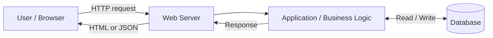
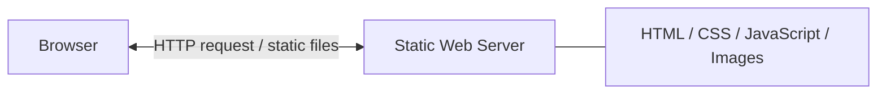
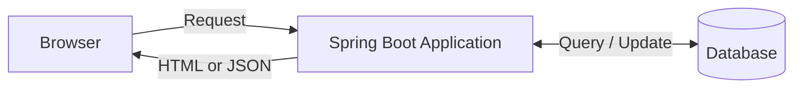
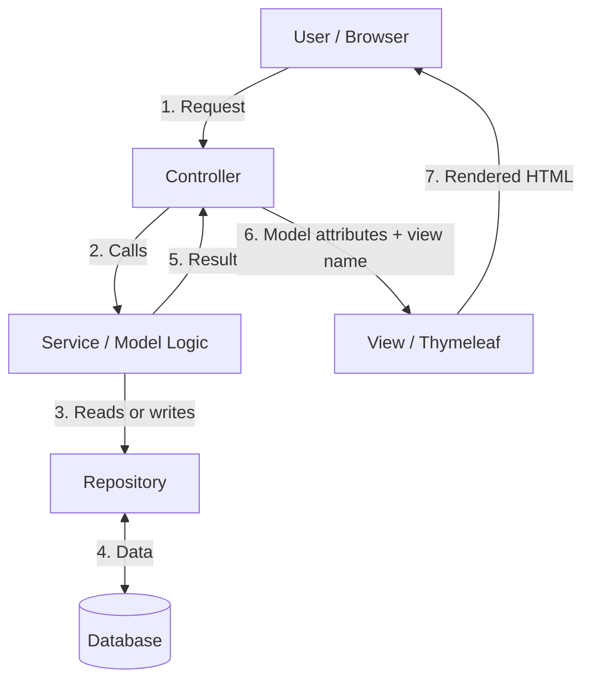

# Web Applications – Complete Student Notes

**Topics:** Web Applications, Static vs Dynamic Websites, MVC Architecture, Spring Boot Examples

## 1. What is a Web Application?

A **web application** is software accessed through a web browser over a network. The browser sends HTTP requests to a server and receives responses such as HTML, CSS, JavaScript, images, or JSON.

**Examples:** Gmail, Amazon, Flipkart, online banking, and employee management systems.

### How a Web Application Works



1. The user opens `http://localhost:8080/employees`.
2. The browser sends an HTTP request.
3. The web server routes the request to the application.
4. The application executes business logic.
5. If necessary, it reads or writes data in a database.
6. The server sends an HTTP response.
7. The browser displays the result.

> **Note:** Not every web application needs a database. The web server and application can also be part of the same deployed process.

## 2. Types of Web Applications

Two useful categories are:

- **Static web applications:** Primarily serve prebuilt files and content.
- **Dynamic web applications:** Generate or update content using requests, users, data, or business logic.

## 3. Static Web Application

A static website serves HTML, CSS, JavaScript, images, and other assets. The files are typically delivered as built, although JavaScript can still add interactivity.

### Architecture



### Example: College Information Website

A college website may display courses, departments, address, contact details, and admission information. Most visitors receive the same published pages. To change published information, the administrator updates the files or content and republishes them.

### Example HTML

```html
<!DOCTYPE html>
<html>
<head>
    <title>JavaCodeEx Training</title>
</head>
<body>
    <h1>Welcome to JavaCodeEx</h1>
    <h2>Spring Boot Training</h2>
    <p>Learn Java and Spring Boot.</p>
</body>
</html>
```

Save as `index.html` and open in a browser.

### Advantages

- Simple to develop and deploy.
- Often fast to load.
- Low hosting costs.
- Smaller server-side attack surface.
- Good for informational websites.

### Limitations

- Updating content may require republishing.
- User-specific server-side functionality requires additional services.
- Complex workflows such as payments and account management need backend integration.

### Suitable Use Cases

Portfolios, documentation, brochures, company information websites, and marketing landing pages.

> **Interview tip:** A static website can use JavaScript, animations, client-side validation, and API calls. Static does **not** mean non-interactive.

## 4. Dynamic Web Application

A dynamic application generates or retrieves content based on the request, user, database state, or business rules.

### Example: E-commerce

Customer A and Customer B open the same shopping website, but each sees their own orders and account information. The application retrieves relevant records and returns personalized responses.

### Architecture



### Spring Boot Example

**Employee.java**

```java
public record Employee(Long id, String name, Double salary) {}
```

**EmployeeController.java**

```java
@RestController
@RequestMapping("/employees")
public class EmployeeController {

    @GetMapping("/{id}")
    public Employee getEmployee(@PathVariable Long id) {
        return new Employee(id, "Ravi", 50000.0);
    }
}
```

Request:

```http
GET http://localhost:8080/employees/101
```

Response:

```json
{
  "id": 101,
  "name": "Ravi",
  "salary": 50000.0
}
```

This example demonstrates a dynamically generated response but uses hardcoded sample data. A real application would typically retrieve the matching employee from a database and handle missing records.

### Advantages

- Personalized content.
- Database integration.
- Login, registration, and business workflows.
- Supports complex features and real-time updates.

### Challenges

- More complex to develop and test.
- Requires security, monitoring, and maintenance.
- May need more hosting resources.
- Performance depends on application and database design.

### Suitable Use Cases

Banking, social media, shopping, hospital management, booking, and employee management systems.

## 5. Static vs Dynamic Comparison

| Feature | Static Web Application | Dynamic Web Application |
|---|---|---|
| Content | Primarily prebuilt | Generated or retrieved based on data or requests |
| Backend | Not required to serve static files | Often required |
| Database | Optional | Common, but not mandatory |
| Personalization | Limited without APIs/services | Common |
| Development | Usually simpler | Usually more complex |
| Hosting | Often inexpensive | Depends on infrastructure |
| Example | Portfolio | Employee management system |

**Modern hybrid example:** A React frontend may be served as static files but call a Spring Boot REST API for dynamic employee data.

## 6. What is MVC Architecture?

**MVC = Model – View – Controller.** It is an architectural pattern that separates responsibilities within an application.

- **Model:** Represents application data and domain behavior. Services and repositories commonly support the domain model in Spring applications.
- **View:** Presents data to the user, such as HTML rendered by Thymeleaf.
- **Controller:** Receives requests, delegates operations, and selects a view or returns a response.

### Why MVC?

Without separation, one class might handle UI rendering, validation, salary calculations, and database access. Such code is difficult to maintain and test. MVC helps organize responsibilities.

### MVC Flow



### Employee Details Flow

1. User requests `/employees/101`.
2. Controller accepts the request.
3. Controller calls `EmployeeService`.
4. Service retrieves the employee, possibly using a repository.
5. Service returns the employee.
6. Controller adds employee data to the model.
7. Controller selects the Thymeleaf view.
8. The server renders HTML and returns it to the browser.

## 7. MVC Implementation with Spring Boot

### Project Structure

```text
com.javacodeex.employee
├── controller
│   └── EmployeeController.java
├── service
│   └── EmployeeService.java
├── repository
│   └── EmployeeRepository.java  (optional for this sample)
├── entity
│   └── Employee.java
└── resources
    └── templates
        └── employee.html
```

Add the **Spring Web** and **Thymeleaf** dependencies. The following is a simple working example with in-memory sample data; a repository is not used yet. Put Java classes in their appropriate packages and include required imports.

### Step 1: Model – Employee.java

```java
public class Employee {
    private Long id;
    private String name;
    private double salary;

    public Employee(Long id, String name, double salary) {
        this.id = id;
        this.name = name;
        this.salary = salary;
    }

    public Long getId() { return id; }
    public String getName() { return name; }
    public double getSalary() { return salary; }
}
```

### Step 2: Service – EmployeeService.java

```java
@Service
public class EmployeeService {
    public Employee getEmployee(Long id) {
        return new Employee(id, "Ravi", 50000);
    }
}
```

### Step 3: Controller – EmployeeController.java

```java
@Controller
@RequestMapping("/employees")
public class EmployeeController {
    private final EmployeeService service;

    public EmployeeController(EmployeeService service) {
        this.service = service;
    }

    @GetMapping("/{id}")
    public String getEmployee(@PathVariable Long id, Model model) {
        Employee employee = service.getEmployee(id);
        model.addAttribute("employee", employee);
        return "employee";
    }
}
```

`@Controller` marks an MVC controller. The return value `"employee"` identifies the Thymeleaf template, rather than a JSON response.

### Step 4: View – resources/templates/employee.html

```html
<!DOCTYPE html>
<html xmlns:th="http://www.thymeleaf.org">
<head>
    <title>Employee Details</title>
</head>
<body>
    <h2>Employee Details</h2>
    <p>ID: <span th:text="${employee.id}"></span></p>
    <p>Name: <span th:text="${employee.name}"></span></p>
    <p>Salary: <span th:text="${employee.salary}"></span></p>
</body>
</html>
```

### Output

Visit `http://localhost:8080/employees/101`:

```text
Employee Details
ID: 101
Name: Ravi
Salary: 50000.0
```

## 8. `@Controller` vs `@RestController`

| `@Controller` | `@RestController` |
|---|---|
| Common for server-rendered MVC pages | Common for REST APIs |
| Can return a view name | Returns response data by default |
| Often uses Thymeleaf or JSP | Often returns JSON |
| Example: employee details HTML page | Example: employee JSON endpoint |

**MVC page controller:**

```java
@Controller
public class PageController {
    @GetMapping("/home")
    public String home() {
        return "home";
    }
}
```

**REST controller:**

```java
@RestController
public class ApiController {
    @GetMapping("/message")
    public String message() {
        return "Welcome to Spring Boot";
    }
}
```

**Remember:** Spring MVC can be used to build REST APIs too. `@RestController` is a convenience annotation combining `@Controller` with response-body semantics.

## 9. Benefits of MVC

1. **Separation of concerns:** Clear responsibilities.
2. **Maintainability:** Easier to modify individual layers.
3. **Reusability:** Services and domain logic can be reused.
4. **Testability:** Components can be tested independently.
5. **Parallel development:** Teams can work on different areas.
6. **Code organization:** Easier to extend larger applications.

MVC does not automatically guarantee faster runtime performance or horizontally scalable infrastructure.

## 10. Technologies Used in Web Applications

| Layer | Technologies | Purpose |
|---|---|---|
| Frontend | HTML, CSS, JavaScript, React, Angular | User interface |
| Backend | Java, Spring Boot, Node.js, Python | Business logic |
| Database | PostgreSQL, MySQL, Oracle, MongoDB | Persistent storage |
| Web server / reverse proxy | Nginx, Apache HTTP Server | HTTP routing and static content |
| Java servlet container | Tomcat, Jetty | Servlet-based web application execution |

Spring Boot commonly uses embedded Tomcat, so a separate Tomcat installation is usually unnecessary.

## 11. When to Choose Which Approach

| Requirement | Suggested Approach | Example Stack |
|---|---|---|
| Personal portfolio | Static website | HTML, CSS, JavaScript |
| Employee CRUD | Dynamic application | Spring Boot, PostgreSQL, Thymeleaf or React |
| E-commerce | Dynamic layered application | React, Spring Boot, PostgreSQL |
| Server-rendered admin dashboard | MVC | Spring MVC, Thymeleaf, PostgreSQL |

MVC is not an alternative to static or dynamic content. It is a way to structure application responsibilities.

## 12. Interview Questions and Answers

**Q1. What is a web application?**  
A software application accessed through a browser or web client over a network.

**Q2. Static vs dynamic application?**  
Static sites primarily serve prebuilt content; dynamic apps generate or retrieve content based on requests or data.

**Q3. Can a static website call a backend?**  
Yes. Browser JavaScript can call REST APIs.

**Q4. What is MVC?**  
Model-View-Controller, a pattern separating application data, presentation, and request handling.

**Q5. What is a controller responsible for?**  
Receiving requests, delegating application operations, and returning a view or response.

**Q6. `@Controller` vs `@RestController`?**  
`@Controller` commonly renders views; `@RestController` returns response bodies such as JSON.

**Q7. Does MVC require a database?**  
No. Data can come from memory, external APIs, files, or other sources.

**Q8. Can Spring Boot serve web pages and APIs?**  
Yes. It supports server-rendered pages and REST endpoints.

**Q9. What is Thymeleaf?**  
A server-side template engine that renders HTML using model data.

**Q10. MVC vs microservices?**  
MVC separates responsibilities within an application; microservices divide a system into independently deployable services.

## 13. Student Practice Assignment

### Project: Employee Management Web Application

**Requirements:**

1. Create employees with ID, name, and salary.
2. Display employee details.
3. List all employees.
4. Update employee salary.
5. Delete employees.
6. Store employee records in PostgreSQL.
7. Organize code using Controller, Service, and Repository layers.
8. Build a Thymeleaf UI or a frontend that consumes REST APIs.

**Learning outcome:** Understand browser-to-server communication, request handling, business logic, database access, and response rendering.

## 14. Quick Revision

| Concept | Key Idea |
|---|---|
| Web application | Accessed through web clients over HTTP |
| Static site | Serves primarily prebuilt files |
| Dynamic application | Content varies based on requests or data |
| Model | Domain data and behavior |
| View | Presentation |
| Controller | Request handling |
| Spring Boot | Java framework for backend applications |
| Thymeleaf | HTML template engine |
| REST API | HTTP-based interface for resources and operations |
| PostgreSQL | Relational database |

> **Final takeaway:** Static and dynamic describe how web content is served or generated. MVC describes how responsibilities are organized. A dynamic Spring Boot application can use MVC and also serve static files.
