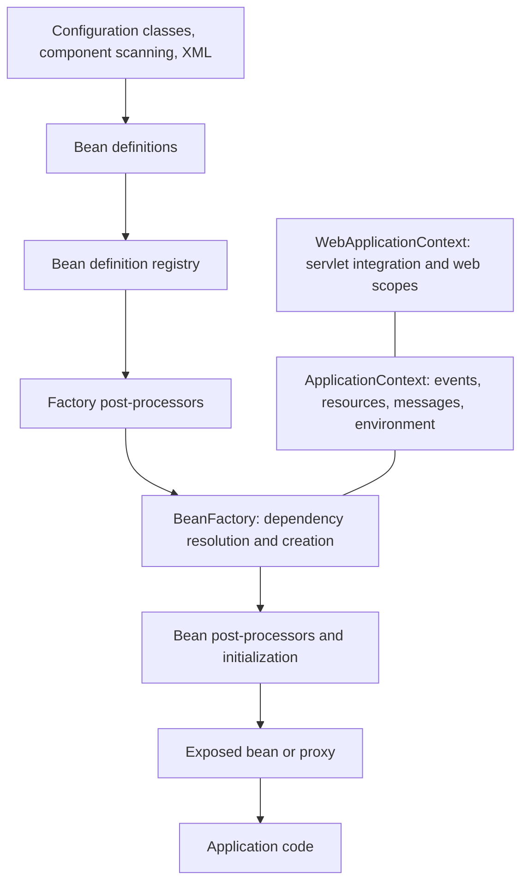
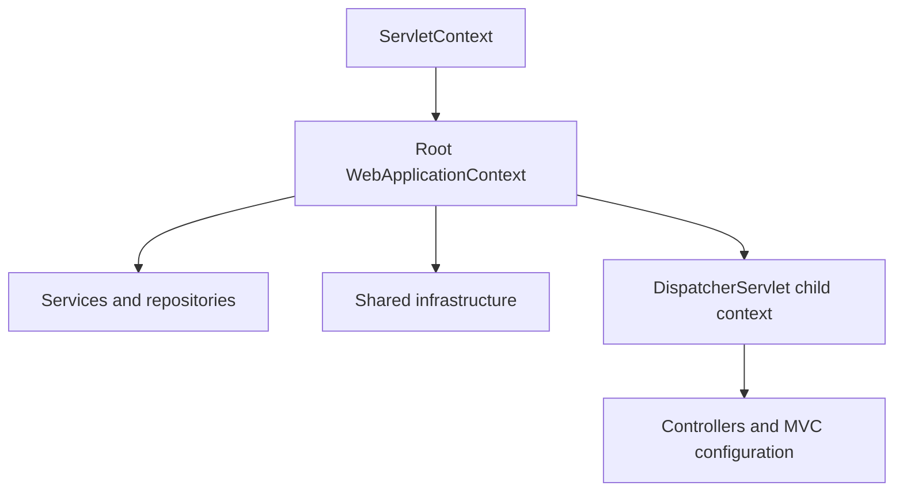
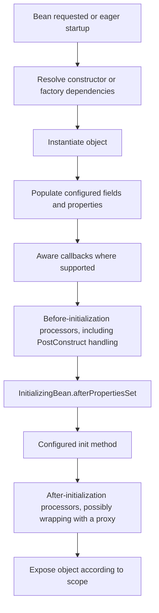
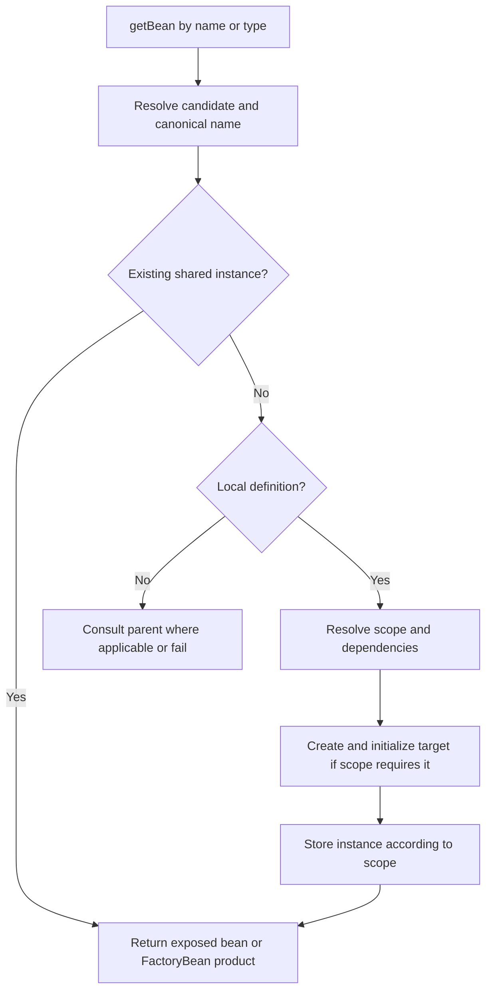
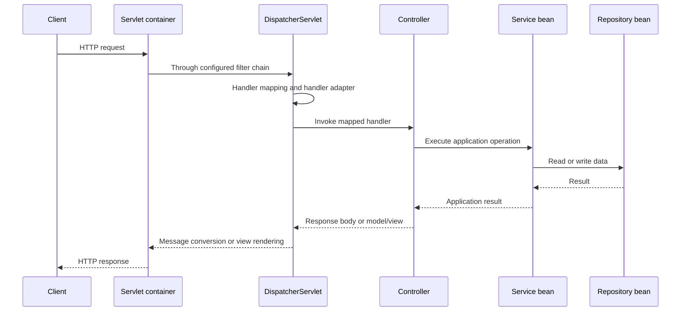

# Spring Container, BeanFactory, ApplicationContext, and WebApplicationContext

Detailed study notes with use cases, method references, Java examples, bean scopes, lifecycle, and architectural and functional flows.

**Baseline:** modern Spring Framework using Java configuration. Lifecycle examples use `jakarta.annotation` imports, as used with Spring Framework 6 and later. The servlet examples concern Spring MVC; reactive WebFlux has a different web infrastructure. Examples are independent unless explicitly connected.

## 1. Learning roadmap

1. Understand the container, bean definitions, and dependency injection.
2. Compare `BeanFactory`, `ApplicationContext`, and `WebApplicationContext`.
3. Learn which interface owns each commonly used method.
4. Choose bean scopes and handle dependencies between different scopes.
5. Trace bean creation, initialization, use, and destruction.
6. Connect container startup to application execution and HTTP request handling.

## 2. What is the Spring container?

The Spring IoC container manages application objects and their relationships. **IoC**, or Inversion of Control, means that application classes delegate object assembly to the framework. **DI**, or Dependency Injection, is the mechanism by which their required collaborators are supplied.

Consider an order application:

```text
OrderService needs OrderRepository
OrderRepository needs a DataSource

Without DI: OrderService constructs its own repository and its configuration.
With DI:    OrderService receives a repository through its constructor.
```

A **bean** is an object managed by Spring. A **bean definition** is the recipe describing how Spring should obtain that object: its class or factory method, dependencies, scope, lazy setting, and initialization or destruction callbacks.

The definition and the object are different. Registering a definition does not necessarily create an instance immediately. A prototype definition can produce many objects; a lazy singleton may remain uncreated until needed.

### 2.1 Responsibilities and boundaries

The container assembles the application graph and applies configured infrastructure. Your classes still implement business rules. A service method is executed when application code, a scheduler, a listener, or a web adapter calls it; merely registering a service does not execute every method.

An object created by ordinary application code with `new` is not automatically registered or processed. However, using `new` inside an `@Bean` method is normal: Spring manages the returned object.

```java
@Bean
OrderService orderService(OrderRepository repository) {
    return new OrderService(repository);
}
```

### 2.2 Architecture



Think of the definition registry as a catalog of recipes, the factory as the object assembly engine, and the context as the application environment around that engine.

## 3. Interface relationships

The correct names are **`BeanFactory`**, **`ApplicationContext`**, and **`WebApplicationContext`**.

```text
BeanFactory
├── ListableBeanFactory             enumeration and type-based searches
└── HierarchicalBeanFactory         parent-factory access

ApplicationContext extends both above, plus:
    MessageSource
    ApplicationEventPublisher
    EnvironmentCapable
    ResourcePatternResolver → ResourceLoader

WebApplicationContext extends ApplicationContext

ConfigurableApplicationContext extends ApplicationContext + lifecycle/close contracts
ConfigurableWebApplicationContext combines configurable and servlet context contracts
```

These are interfaces, not three unrelated container products. A web context exposes the application-context and bean-factory APIs too. Typical context implementations delegate bean storage and creation to an internal `DefaultListableBeanFactory`.

| Requirement | Appropriate starting point |
|---|---|
| Normal Java application | `AnnotationConfigApplicationContext` |
| Spring Boot application | Context created by `SpringApplication.run(...)` |
| Existing classpath XML configuration | `ClassPathXmlApplicationContext` |
| XML configuration from a filesystem location | `FileSystemXmlApplicationContext` |
| Programmatic infrastructure integration | `GenericApplicationContext` |
| Low-level control over factory bootstrapping | `DefaultListableBeanFactory` |
| Servlet application with Java configuration | `AnnotationConfigWebApplicationContext` |
| Servlet application with XML configuration | `XmlWebApplicationContext` |

Spring recommends an application context for ordinary applications. A raw factory needs explicit infrastructure setup, including processor registration; it does not automatically activate every specially typed bean. See the [BeanFactory reference](https://docs.spring.io/spring-framework/reference/core/beans/beanfactory.html).

## 4. BeanFactory in detail

`BeanFactory` is the basic client contract for locating beans. Configuration and registration belong to additional interfaces and implementation classes.

### 4.1 Common methods

| Method | Purpose | Example |
|---|---|---|
| `getBean(String)` | Lookup by name; returns `Object` | `factory.getBean("orderService")` |
| `getBean(Class<T>)` | Resolve a bean by type | `factory.getBean(OrderService.class)` |
| `getBean(String, Class<T>)` | Named lookup with type checking | `factory.getBean("orderService", OrderService.class)` |
| `getBean(String, Object...)` | Supply creation arguments, commonly for prototypes | `factory.getBean("report", "April")` |
| `getBeanProvider(Class<T>)` | Obtain an on-demand provider | `factory.getBeanProvider(OrderService.class)` |
| `containsBean(String)` | Check whether a name is known, including parent lookup | `factory.containsBean("orderService")` |
| `isSingleton(String)` | Check singleton semantics | `factory.isSingleton("orderService")` |
| `isPrototype(String)` | Check prototype semantics | `factory.isPrototype("report")` |
| `getType(String)` | Determine bean type when possible | `factory.getType("orderService")` |
| `isTypeMatch(String, Class<?>)` | Check type compatibility | `factory.isTypeMatch("orderService", OrderService.class)` |
| `getAliases(String)` | Retrieve alternative names | `factory.getAliases("orderService")` |

Type lookup can fail when no bean exists or when multiple candidates cannot be resolved. `containsBean` is not a guarantee that creation will succeed. Explicit arguments apply to creation, not reconfiguration of an existing singleton. Method contracts are documented in the [BeanFactory Javadoc](https://docs.spring.io/spring-framework/docs/current/javadoc-api/org/springframework/beans/factory/BeanFactory.html).

### 4.2 Complete low-level example

With `spring-context` on the classpath, save this as `FactoryDemo.java`. It deliberately uses explicit constructor wiring rather than annotation processing.

```java
import org.springframework.beans.factory.config.RuntimeBeanReference;
import org.springframework.beans.factory.support.DefaultListableBeanFactory;
import org.springframework.beans.factory.support.RootBeanDefinition;

public class FactoryDemo {
    public static class OrderRepository {
        public void save(String item) {
            System.out.println("Saved: " + item);
        }
    }

    public static class OrderService {
        private final OrderRepository repository;

        public OrderService(OrderRepository repository) {
            this.repository = repository;
            System.out.println("OrderService constructed");
        }

        public void placeOrder(String item) {
            repository.save(item);
        }
    }

    public static void main(String[] args) {
        var factory = new DefaultListableBeanFactory();
        try {
            factory.registerBeanDefinition("orderRepository",
                    new RootBeanDefinition(OrderRepository.class));

            var definition = new RootBeanDefinition(OrderService.class);
            definition.getConstructorArgumentValues().addIndexedArgumentValue(
                    0, new RuntimeBeanReference("orderRepository"));
            factory.registerBeanDefinition("orderService", definition);

            System.out.println("Definitions registered");
            var first = factory.getBean(OrderService.class);
            var second = factory.getBean("orderService", OrderService.class);
            System.out.println(first == second);
            first.placeOrder("Notebook");
        } finally {
            factory.destroySingletons();
        }
    }
}
```

Expected output:

```text
Definitions registered
OrderService constructed
true
Saved: Notebook
```

`registerBeanDefinition` is a registry operation exposed by the implementation, not a method on the base `BeanFactory` interface. `destroySingletons` is likewise a configurable-factory operation. You can request eager creation with `preInstantiateSingletons()`; therefore “BeanFactory can only create beans lazily” is incorrect.

### 4.3 BeanFactory versus FactoryBean

| Name | Meaning |
|---|---|
| `BeanFactory` | Container access contract |
| `FactoryBean<T>` | A managed factory that supplies an object of type `T` |

For a `FactoryBean` registered as `client`, `getBean("client")` obtains its product and `getBean("&client")` obtains the factory object. Typical uses include infrastructure that constructs specialized clients or proxies. A `FactoryBean` implements `getObject()`, `getObjectType()`, and singleton-product semantics through `isSingleton()`. Product lifecycle details differ from ordinary bean creation; do not assume the container automatically owns all resources of a factory-produced object. See [container extension points](https://docs.spring.io/spring-framework/reference/core/beans/factory-extension.html).

## 5. ApplicationContext in detail

`ApplicationContext` adds application-level facilities: bean enumeration, hierarchy, messages, resources, environment access, and event publication. Its implementations coordinate startup and infrastructure processing. See the [ApplicationContext API](https://docs.spring.io/spring-framework/docs/current/javadoc-api/org/springframework/context/ApplicationContext.html).

### 5.1 Complete Java configuration example

Save as `ContextDemo.java` in a project with `spring-context`.

```java
import org.springframework.context.annotation.AnnotationConfigApplicationContext;
import org.springframework.context.annotation.Bean;
import org.springframework.context.annotation.Configuration;

public class ContextDemo {
    public static class OrderRepository {
        public void save(String item) {
            System.out.println("Saved: " + item);
        }
    }

    public static class OrderService {
        private final OrderRepository repository;

        public OrderService(OrderRepository repository) {
            this.repository = repository;
            System.out.println("Service created");
        }

        public void placeOrder(String item) {
            repository.save(item);
        }
    }

    @Configuration(proxyBeanMethods = false)
    public static class AppConfig {
        @Bean
        OrderRepository orderRepository() {
            return new OrderRepository();
        }

        @Bean(name = {"orderService", "orders"})
        OrderService orderService(OrderRepository repository) {
            return new OrderService(repository);
        }
    }

    public static void main(String[] args) {
        try (var context = new AnnotationConfigApplicationContext(AppConfig.class)) {
            System.out.println("Context ready");
            context.getBean(OrderService.class).placeOrder("Keyboard");
            System.out.println(context.getBean("orders")
                    == context.getBean("orderService"));
        }
    }
}
```

Expected output:

```text
Service created
Context ready
Saved: Keyboard
true
```

The constructor used here registers configuration and refreshes the context. Default non-lazy singletons are initialized before it returns. With `proxyBeanMethods = false`, use bean method parameters for dependencies; a direct Java call to another `@Bean` method would execute that method normally.

### 5.2 Common context methods and their owners

| Method | Declaring contract | Typical use |
|---|---|---|
| `getBean(...)` | `BeanFactory` | Obtain an entry-point object |
| `getBeanDefinitionNames()` | `ListableBeanFactory` | Inspect local definitions |
| `getBeanDefinitionCount()` | `ListableBeanFactory` | Count local definitions |
| `getBeansOfType(T.class)` | `ListableBeanFactory` | Find local strategy implementations |
| `getBeanNamesForType(T.class)` | `ListableBeanFactory` | Discover matching local names |
| `containsLocalBean(name)` | `HierarchicalBeanFactory` | Check local ownership |
| `getParent()` | `ApplicationContext` | Inspect context hierarchy |
| `getId()`, `getDisplayName()` | `ApplicationContext` | Diagnostics |
| `getStartupDate()` | `ApplicationContext` | Startup timestamp |
| `getEnvironment()` | `EnvironmentCapable` | Read properties and profiles |
| `getResource(location)` | `ResourceLoader` | Read one resource |
| `getResources(pattern)` | `ResourcePatternResolver` | Find multiple resources |
| `getMessage(...)` | `MessageSource` | Resolve localized text |
| `publishEvent(event)` | `ApplicationEventPublisher` | Notify application listeners |

Enumeration methods generally concern the local factory, whereas ordinary named lookup can delegate to a parent. For ancestor-inclusive discovery, use the appropriate `BeanFactoryUtils` helper. Calling `getBeansOfType` can instantiate beans; it is not necessarily passive inspection.

### 5.3 Environment and resource examples

These snippets assume an active context named `context`:

```java
String region = context.getEnvironment().getProperty("app.region", "local");
String[] profiles = context.getEnvironment().getActiveProfiles();

var resource = context.getResource("classpath:templates/welcome.txt");
try (var input = resource.getInputStream()) {
    String template = new String(input.readAllBytes(),
            java.nio.charset.StandardCharsets.UTF_8);
    System.out.println(template);
}

var resources = context.getResources("classpath*:templates/*.txt");
```

Create `src/main/resources/templates/welcome.txt` before running the resource example. Use streams for classpath resources: a resource inside a JAR may not be accessible as a normal filesystem `File`. Plain Spring does not automatically apply every Spring Boot configuration-file convention.

### 5.4 Internationalization example

Add this method to a configuration class:

```java
@Bean
org.springframework.context.support.ResourceBundleMessageSource messageSource() {
    var source = new org.springframework.context.support.ResourceBundleMessageSource();
    source.setBasename("messages");
    source.setDefaultEncoding("UTF-8");
    return source;
}
```

Create `src/main/resources/messages.properties`:

```properties
order.accepted=Order {0} accepted
```

Then:

```java
String message = context.getMessage("order.accepted",
        new Object[]{"A101"}, java.util.Locale.ENGLISH);
```

Use the reserved bean name `messageSource` for the context's message source.

### 5.5 Application events example

Register `OrderAudit` as a bean using scanning or an `@Bean` method:

```java
record OrderPlaced(String orderId) {}

class OrderAudit {
    @org.springframework.context.event.EventListener
    public void onOrderPlaced(OrderPlaced event) {
        System.out.println("Audit: " + event.orderId());
    }
}

// After context startup:
// context.publishEvent(new OrderPlaced("A101"));
```

With the default event multicaster and ordinary listeners, delivery is synchronous. Events do not automatically provide a durable queue, asynchronous execution, or delivery after a database commit. Those behaviors need separate configuration or mechanisms.

### 5.6 ConfigurableApplicationContext methods

| Method | Meaning and use |
|---|---|
| `refresh()` | Initialize the context from its registered configuration |
| `close()` | Close the context and destroy managed singletons |
| `registerShutdownHook()` | Arrange cleanup on normal JVM shutdown |
| `isActive()` | Check whether the context is active |
| `getBeanFactory()` | Access the underlying configurable factory |
| `addApplicationListener(listener)` | Register a listener programmatically |
| `addBeanFactoryPostProcessor(processor)` | Add definition-processing infrastructure before refresh |
| `start()` / `stop()` | Coordinate `Lifecycle` components |

`stop()` is not equivalent to `close()`. Calling `refresh()` repeatedly is not supported by every implementation; `AnnotationConfigApplicationContext` supports a single refresh. See [ConfigurableApplicationContext](https://docs.spring.io/spring-framework/docs/current/javadoc-api/org/springframework/context/ConfigurableApplicationContext.html).

For setup before refresh:

```java
try (var context = new AnnotationConfigApplicationContext()) {
    context.getEnvironment().setActiveProfiles("dev");
    context.register(ContextDemo.AppConfig.class);
    context.refresh();
    context.getBean(ContextDemo.OrderService.class).placeOrder("Mouse");
}
```

Use constructor injection inside business classes. Repeated context lookups throughout the domain layer create unnecessary container coupling.

## 6. WebApplicationContext in detail

A `WebApplicationContext` is an application context associated with a Servlet environment. It integrates with `ServletContext` and web scopes. It is not the HTTP server itself and does not replace Tomcat or another servlet container.

| Component | Responsibility |
|---|---|
| Servlet container | Connections, servlet lifecycle, HTTP request/response infrastructure |
| `ServletContext` | Servlet application metadata and shared attributes |
| `WebApplicationContext` | Spring beans and servlet-aware integration |
| `DispatcherServlet` | Spring MVC request dispatch |

### 6.1 Methods and utilities

| API | Use |
|---|---|
| `webContext.getServletContext()` | Access the associated servlet context; may be null before association |
| Inherited `getBean(...)` | Obtain a web or application bean |
| Inherited `getEnvironment()` | Access the web environment |
| Inherited `getParent()` | Inspect the parent Spring context |
| `WebApplicationContextUtils.getWebApplicationContext(servletContext)` | Find the root context, or null if absent |
| `WebApplicationContextUtils.getRequiredWebApplicationContext(servletContext)` | Require a root context; fail if absent |
| `ConfigurableWebApplicationContext.setServletContext(...)` | Associate servlet infrastructure during bootstrap |
| `ConfigurableWebApplicationContext.setConfigLocation(...)` | Set an implementation-specific configuration location |

The utility methods are static methods on a separate helper class. They are not methods declared by `WebApplicationContext`. The interface also defines scope-name constants such as `SCOPE_REQUEST`, `SCOPE_SESSION`, and `SCOPE_APPLICATION`. See the [WebApplicationContext API](https://docs.spring.io/spring-framework/docs/current/javadoc-api/org/springframework/web/context/WebApplicationContext.html).

### 6.2 Traditional root and child arrangement



A child can resolve dependencies from its parent. A parent cannot look down into its children; siblings do not automatically see each other's beans. A local bean can shadow a parent bean of the same name. Avoid scanning the same service packages into both contexts, which can create duplicate instances.

A root/child hierarchy is optional. A single web context is sufficient for many applications. See [Spring MVC context hierarchies](https://docs.spring.io/spring-framework/reference/web/webmvc/mvc-servlet/context-hierarchy.html).

### 6.3 Servlet bootstrap example

In a traditional WAR project with `spring-webmvc`, a compatible Servlet API, and a compatible servlet container, use separate configuration classes:

```java
import org.springframework.context.annotation.ComponentScan;
import org.springframework.context.annotation.Configuration;
import org.springframework.web.servlet.config.annotation.EnableWebMvc;
import org.springframework.web.servlet.support.AbstractAnnotationConfigDispatcherServletInitializer;

public class WebInitializer
        extends AbstractAnnotationConfigDispatcherServletInitializer {
    @Override
    protected Class<?>[] getRootConfigClasses() {
        return new Class<?>[]{RootConfig.class};
    }

    @Override
    protected Class<?>[] getServletConfigClasses() {
        return new Class<?>[]{MvcConfig.class};
    }

    @Override
    protected String[] getServletMappings() {
        return new String[]{"/"};
    }
}

@Configuration
@ComponentScan("com.example.application")
class RootConfig {}

@Configuration
@EnableWebMvc
@ComponentScan("com.example.web")
class MvcConfig {}
```

Place services/repositories in `com.example.application` and controllers in `com.example.web`. This illustrates container setup, not a complete deployable web application. A typical Boot application lets Boot configure its context and servlet infrastructure instead of adding this initializer.

## 7. Bean scopes

Scope answers: **which lookup or execution boundary shares an instance?**

| Scope | Instance boundary | Example use |
|---|---|---|
| `singleton` | One instance per definition per container | Stateless pricing service |
| `prototype` | New instance per container resolution | Mutable report builder |
| `request` | One target per HTTP request | Request metadata |
| `session` | One target per HTTP session | Shopping cart |
| `application` | One target per ServletContext | Web-application shared state |
| `websocket` | One target per WebSocket session in configured messaging support | Conversation state |

`singleton` is the default. Web scopes need their supporting infrastructure. Prototype initialization is managed, but automatic prototype destruction is not. Scoped proxies or providers bridge dependencies with different lifetimes. See [bean scopes](https://docs.spring.io/spring-framework/reference/core/beans/factory-scopes.html).

### 7.1 Singleton example

```java
@Bean
PricingService pricingService() {
    return new PricingService();
}

// In the same context:
// context.getBean(PricingService.class) == context.getBean(PricingService.class)
// true
```

Two separately named definitions of the same class can produce two singleton objects. Two independent contexts can also have different instances. Spring singleton is therefore different from a JVM-wide static singleton.

Singleton does not imply thread safety. Avoid storing a current user, current order, or per-call mutable result in singleton service fields. Method-local data keeps simultaneous calls from overwriting one another.

### 7.2 Prototype example

```java
class ReportBuilder {
    private final StringBuilder text = new StringBuilder();

    public void append(String value) {
        text.append(value);
    }

    public String build() {
        return text.toString();
    }
}

// Inside a configuration class:
@Bean
@org.springframework.context.annotation.Scope("prototype")
ReportBuilder reportBuilder() {
    return new ReportBuilder();
}
```

Two calls to `context.getBean(ReportBuilder.class)` produce different builders. Two method calls on the same builder reference still use that one object.

### 7.3 Prototype injected into a singleton

This constructor receives one builder when the singleton is created:

```java
class IncorrectReportService {
    private final ReportBuilder builder;

    IncorrectReportService(ReportBuilder builder) {
        this.builder = builder;
    }
}
```

The container does not repeat constructor injection for every business call. Request the prototype at the point where a fresh instance is required:

```java
import org.springframework.beans.factory.ObjectProvider;

class ReportService {
    private final ObjectProvider<ReportBuilder> builders;

    ReportService(ObjectProvider<ReportBuilder> builders) {
        this.builders = builders;
    }

    public String generate(String title) {
        ReportBuilder builder = builders.getObject();
        builder.append(title);
        return builder.build();
    }
}

// Configuration:
@Bean
ReportService reportService(ObjectProvider<ReportBuilder> builders) {
    return new ReportService(builders);
}
```

`getObject()` resolves a bean according to its scope; it does not universally mean “create a new object.” `getIfAvailable()` supports absence but can still fail for unresolved ambiguity. `getIfUnique()` also handles lack of a unique candidate by returning null. See [ObjectProvider](https://docs.spring.io/spring-framework/docs/current/javadoc-api/org/springframework/beans/factory/ObjectProvider.html).

### 7.4 Request and session examples

Register these classes through component scanning in a servlet application:

```java
import java.util.UUID;
import org.springframework.stereotype.Component;
import org.springframework.web.context.annotation.RequestScope;

@Component
@RequestScope
public class RequestTrace {
    private final String id = UUID.randomUUID().toString();

    public String id() {
        return id;
    }
}
```

```java
import java.util.ArrayList;
import java.util.List;
import org.springframework.stereotype.Component;
import org.springframework.web.context.annotation.SessionScope;

@Component
@SessionScope
public class ShoppingCart {
    private final List<String> items = new ArrayList<>();

    public synchronized void add(String item) {
        items.add(item);
    }

    public synchronized List<String> items() {
        return List.copyOf(items);
    }
}
```

The request trace changes between requests. The cart survives successive requests belonging to the same session. Sessions can receive concurrent requests; the sample synchronizes list access, but real cart operations also need appropriate consistency rules and persistence decisions.

`@RequestScope` and `@SessionScope` use a class-based scoped proxy by default. Keep proxied classes and callable methods compatible with subclassing, or deliberately configure an interface proxy.

```text
Singleton service
    → stable request-scoped proxy
        → target for request A when A calls it
        → target for request B when B calls it
```

The proxy is injectable during startup, but invoking its target requires an active request. A scheduler or arbitrary background thread does not automatically inherit that request context. Pass explicit immutable data into background work.

### 7.5 Application, WebSocket, and custom scopes

Use `@ApplicationScope` for ServletContext-wide objects. Application scope can cross multiple Spring contexts associated with that servlet application, unlike a singleton owned by one factory.

For Spring WebSocket messaging, a definition can use:

```java
@org.springframework.context.annotation.Scope(
        value = "websocket",
        proxyMode = org.springframework.context.annotation.ScopedProxyMode.TARGET_CLASS)
```

This requires the corresponding messaging scope infrastructure; merely declaring a web context does not establish a WebSocket session.

Custom scopes implement `org.springframework.beans.factory.config.Scope`, with operations including `get`, `remove`, `registerDestructionCallback`, `resolveContextualObject`, and `getConversationId`. Register them through a configurable factory before use. A tenant or workflow scope must define storage, cleanup, and concurrency semantics explicitly.

## 8. Bean lifecycle

Bean lifecycle concerns one managed object. Context lifecycle concerns startup and shutdown of the entire container. They are related but not identical.

### 8.1 Normal creation flow



This is a teaching model for ordinary beans. Specialized processors can intervene earlier, and circular-reference machinery complicates the sequence. Constructor dependencies must exist before construction; field/setter dependencies are populated afterward.

### 8.2 Initialization and destruction hooks

| Mechanism | Initialization | Destruction |
|---|---|---|
| Jakarta annotations | `@PostConstruct` | `@PreDestroy` |
| Spring interfaces | `InitializingBean.afterPropertiesSet()` | `DisposableBean.destroy()` |
| Bean metadata | `@Bean(initMethod = "open")` | `@Bean(destroyMethod = "close")` |

For distinct callback methods, initialization runs annotation callback, interface callback, then configured init method. Destruction runs annotation callback, interface callback, then configured destroy method. Annotation callbacks are implemented through processors. Prefer one mechanism per concern; combining them is useful for studying order, but usually unnecessary. See [bean lifecycle callbacks](https://docs.spring.io/spring-framework/reference/core/beans/factory-nature.html).

### 8.3 Complete lifecycle demonstration

Requires `spring-context` and `jakarta.annotation-api`. Save as `LifecycleDemo.java`:

```java
import jakarta.annotation.PostConstruct;
import jakarta.annotation.PreDestroy;
import org.springframework.beans.factory.DisposableBean;
import org.springframework.beans.factory.InitializingBean;
import org.springframework.context.annotation.AnnotationConfigApplicationContext;
import org.springframework.context.annotation.Bean;
import org.springframework.context.annotation.Configuration;

public class LifecycleDemo {
    public static class ManagedClient implements InitializingBean, DisposableBean {
        public ManagedClient() {
            System.out.println("1 constructor");
        }

        @PostConstruct
        public void validate() {
            System.out.println("2 postConstruct");
        }

        @Override
        public void afterPropertiesSet() {
            System.out.println("3 afterPropertiesSet");
        }

        public void open() {
            System.out.println("4 custom init");
        }

        public void execute() {
            System.out.println("5 business operation");
        }

        @PreDestroy
        public void prepareToClose() {
            System.out.println("6 preDestroy");
        }

        @Override
        public void destroy() {
            System.out.println("7 destroy");
        }

        public void close() {
            System.out.println("8 custom destroy");
        }
    }

    @Configuration(proxyBeanMethods = false)
    public static class Config {
        @Bean(initMethod = "open", destroyMethod = "close")
        ManagedClient client() {
            return new ManagedClient();
        }
    }

    public static void main(String[] args) {
        try (var context = new AnnotationConfigApplicationContext(Config.class)) {
            context.getBean(ManagedClient.class).execute();
        }
    }
}
```

Expected output is the eight numbered lines in order. If this bean is changed to prototype, initialization occurs for each resolution, but closing the context will not automatically invoke its destruction callbacks. The caller must manage cleanup of prototype-owned resources.

### 8.4 Aware callbacks

| Callback interface | Information supplied | Example reason |
|---|---|---|
| `BeanNameAware` | Bean name | Diagnostic identity |
| `BeanFactoryAware` | Owning factory | Infrastructure integration |
| `ApplicationContextAware` | Application context | Framework adapter |
| `ServletContextAware` | Servlet context | Servlet-level integration |

These callbacks couple a class to Spring. Prefer ordinary constructor parameters for application dependencies. Do not use `ApplicationContextAware` merely to hide missing dependency declarations.

### 8.5 Definition processors versus instance processors

| Extension | Operates on | Example |
|---|---|---|
| `BeanDefinitionRegistryPostProcessor` | Definition registry | Add definitions before ordinary factory processing |
| `BeanFactoryPostProcessor` | Definition metadata | Adjust a property value before bean creation |
| `BeanPostProcessor` | Bean instances | Inspect or wrap an initialized object |

A factory processor should not call `getBean()` indiscriminately: that can instantiate beans too early. Many annotation and proxy features depend on processor infrastructure being ready first. See [container extension points](https://docs.spring.io/spring-framework/reference/core/beans/factory-extension.html).

### 8.6 Lifecycle and SmartLifecycle

`Lifecycle` provides `start()`, `stop()`, and `isRunning()`. `SmartLifecycle` adds phase ordering, automatic startup participation, and a callback-based stop contract. Use these for components such as managed consumers that need coordinated start/stop behavior.

Lower phases normally start first; shutdown reverses phase order. A component implementing `stop(Runnable callback)` must call the callback when stopping completes. This coordination is different from an object's initialization callback or final resource destruction.

## 9. Functional flow: container startup

```text
1. Create an application context.
2. Supply configuration classes, locations, or programmatic definitions.
3. Refresh:
   a. Prepare environment and underlying factory.
   b. Load/register definitions and process configuration.
   c. Run registry and factory post-processors.
   d. Register instance post-processors.
   e. Prepare message source, event multicaster, and listeners.
   f. Initialize eligible non-lazy singletons and their dependencies.
   g. Start auto-start lifecycle components and publish refresh completion.
4. Run application work.
5. Close the context and release managed resources.
```

The actual implementation has additional steps and extension hooks. A failed refresh is not a ready application. An eagerly required dependency can force creation of a lazy bean; `@Lazy` on its definition alone does not guarantee it stays uncreated.

## 10. Functional flow: getBean



For a scoped proxy, resolving the injected reference and resolving the current target happen at different times. For a `FactoryBean`, the exposed result may be its product. The object returned by the container can therefore differ from the raw object originally constructed.

## 11. Functional flow: web request



Container startup usually precedes this flow. A controller does not need to construct a new context per request. Its injected singleton collaborators are normally reused. A request-scoped proxy resolves the target associated with the active request when called.

Interceptors, exception resolvers, security filters, transactions, asynchronous handling, and database connections add further steps when configured. Request dispatch and bean construction are separate flows.

## 12. Functional flow: shutdown

```text
Context close begins
  → publish context-close notification
  → stop lifecycle components
  → destroy managed singletons
      → destruction-aware processors / @PreDestroy
      → DisposableBean.destroy()
      → configured destroy method
  → release context infrastructure
```

Dependency relationships guide destruction: dependent objects are generally destroyed before the objects they depend on. Cleanup at normal shutdown cannot guarantee execution after a forced process termination. Request/session scope cleanup follows the corresponding scope lifecycle rather than this singleton-only sequence.

Use try-with-resources for a short-lived standalone context. For a long-running standalone process, register a shutdown hook. Framework-managed applications should let their owning framework control context shutdown.

## 13. Choosing the right approach

| Scenario | Choice | Reason |
|---|---|---|
| Console program generating one report | Application context in try-with-resources | Predictable initialization and cleanup |
| Business service shared across requests | Stateless singleton | Reusable service without per-user fields |
| Mutable builder for each operation | Prototype obtained through provider | Fresh state per operation |
| Request correlation state | Request scope | Same target throughout one request |
| Session shopping cart | Session scope | State across requests for one session |
| Servlet application-wide registry | Application scope, with concurrency design | Shared servlet-application lifetime |
| Infrastructure library registering definitions | Registry/factory APIs | Explicit control over metadata |
| Consumer needing coordinated shutdown | `SmartLifecycle` | Managed startup/stop participation |

Scope is an ownership decision, not a substitute for persistence. An in-memory session cart or singleton cache does not automatically survive application restarts or synchronize across servers.

## 14. Common problems and diagnosis

| Symptom | Likely cause | What to inspect |
|---|---|---|
| `NoSuchBeanDefinitionException` | Bean not registered | Scanning packages, configuration imports, profiles |
| `NoUniqueBeanDefinitionException` | Unresolved competing candidates | `@Qualifier`, `@Primary`, bean names |
| `BeanNotOfRequiredTypeException` | Wrong required type | Named bean and proxy interfaces |
| `BeanCreationException` | Construction or initialization failed | Deepest cause, not only the wrapper |
| `BeanCurrentlyInCreationException` | Circular dependency | Redesign responsibility boundaries |
| Scope-not-active error | Scoped target accessed outside its context | Background thread, startup callback, missing request |
| Unknown scope | Scope infrastructure not registered | Context type and web/messaging setup |
| Lifecycle annotation ignored | Object unmanaged or processor absent | Manual `new`, raw factory setup, annotation imports |
| Prototype behaves like one shared object | Captured by singleton constructor | Use a provider at operation time |
| Duplicate service initialization | Registered in parent and child | Overlapping component scans |
| `@Transactional` ineffective during init | Proxy interception unavailable/bypassed | Move work to an appropriate externally invoked phase |

Not every initialization method is a suitable place for arbitrary application work. Validate local invariants and initialize owned resources there; coordinate broader application activity after the required infrastructure is ready.

## 15. Revision questions

**Is every Java object a Spring bean?** No. It must participate in container management; merely having a class on the classpath is insufficient.

**Does ApplicationContext replace BeanFactory?** It provides a richer contract that includes bean-factory capabilities, usually backed by an internal factory.

**Does every context eagerly create every bean?** No. Scope, lazy configuration, dependency requirements, and special infrastructure affect creation.

**Does singleton mean one instance per class?** No. It is per bean definition and owning container.

**Does prototype mean a new instance for every method call?** No. A new instance is obtained when the container resolves that prototype.

**Can a parent context use beans from its child?** Not through normal downward lookup. Dependencies should respect the hierarchy.

**Is WebApplicationContext a servlet container?** No. It manages Spring components within a servlet environment.

**Does close destroy prototypes?** Not automatically. Their resource ownership must be handled separately.

**Is a request-scoped proxy the request object itself?** No. It delegates to the target for the current request.

**Why prefer dependency injection over getBean inside services?** Required collaborators remain explicit, and classes can be instantiated directly in focused tests.

## 16. Practice exercises

1. Run `ContextDemo`; mark which output occurs before the first explicit lookup.
2. Add `@Lazy` to `orderService`; observe how creation moves to first use.
3. Change that bean to prototype and compare two lookup results.
4. Run `LifecycleDemo`; explain each of its eight output lines.
5. Change the lifecycle bean to prototype and identify which cleanup lines disappear.
6. Add a second `OrderService` definition and resolve the resulting type ambiguity.
7. Draw the ownership boundary for a singleton service, a session cart, and a request trace.
8. Explain why a background task should receive a trace ID value rather than depend on a live request-scoped target.

The complete examples are teaching programs; surrounding projects must supply compatible dependencies. The remaining snippets illustrate changes inside an existing configuration or application. Expected output is illustrative and has not been executed as part of these notes.

## 17. Related local notes

- [IoC and dependency injection](Spring_IoC_and_Dependency_Injection_Constructor_Setter_Field_Detailed_Notes.md)
- [Spring MVC web applications](Spring_MVC_Web_Application_Detailed_Student_Notes.md)
- [Creating a first Spring Boot service](Creating_First_Spring_Boot_Service_with_Start_Spring_IO.md)

Use the linked official reference pages throughout this document for exact contracts and version-specific details; the `current` documentation URLs can change as Spring releases evolve.
