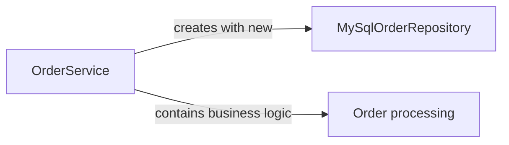
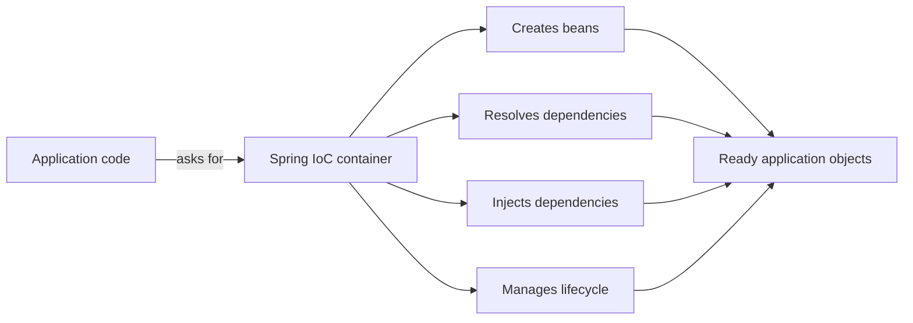
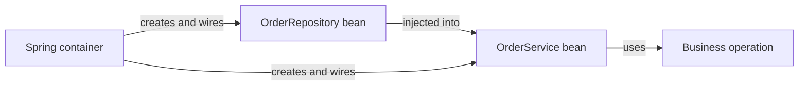
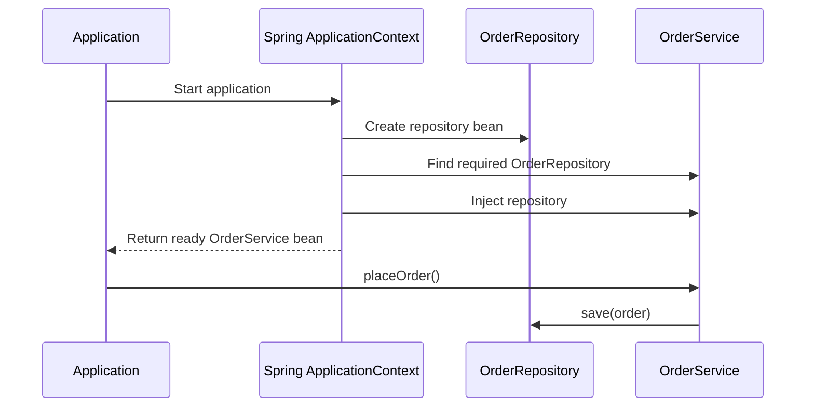

# Spring IoC and Dependency Injection: Constructor, Setter, and Field Injection

## 1. Learning objectives

After studying this note, you should be able to:

- Explain **Inversion of Control (IoC)** and **Dependency Injection (DI)**.
- Describe the role of the Spring IoC container.
- Understand how Spring creates, configures, and connects beans.
- Implement constructor, setter, and field injection.
- Choose the most suitable injection style for a dependency.
- Use `@Qualifier`, `@Primary`, Java configuration, and component scanning.
- Identify common DI errors and avoid circular dependencies.

---

## 2. What is a dependency?

A **dependency** is an object that another object needs in order to perform its work.

For example, an order service may need an order repository:

```java
public class OrderService {

    private OrderRepository orderRepository;
}
```

Here, `OrderService` depends on `OrderRepository`.

The class that uses another object is commonly called the **dependent**, **client**, or **consumer**. The object being used is called the **dependency**.

```text
OrderService  -------------------->  OrderRepository
  dependent                            dependency
```

The dependency may be an interface rather than a concrete class:

```java
public interface PaymentGateway {
    void pay(double amount);
}
```

Depending on an interface makes it easier to replace the implementation and test the dependent class.

---

## 3. Traditional object creation without Spring

In ordinary Java code, a class often creates its own dependencies using `new`:

```java
public class OrderService {

    private final OrderRepository orderRepository = new MySqlOrderRepository();

    public void placeOrder() {
        orderRepository.save();
    }
}
```

This approach works, but it creates tight coupling.

### Problems with direct object creation

1. `OrderService` is coupled to `MySqlOrderRepository`.
2. Replacing MySQL with an in-memory or MongoDB implementation requires changing the service.
3. Unit tests may use a real database accidentally.
4. The service controls both business logic and object creation.
5. Object creation code becomes duplicated across the application.

The dependency relationship is controlled by the class itself:



---

## 4. Inversion of Control (IoC)

**Inversion of Control** means that control over object creation and object wiring is moved from application classes to a framework or container.

Without IoC:

```text
Application class -> creates dependency -> uses dependency
```

With IoC:

```text
Spring container -> creates objects -> connects dependencies -> gives ready object to application
```

The control is inverted because the application class no longer decides how every required object is created.



IoC is a broad principle. Spring implements IoC mainly through **Dependency Injection**, but IoC can also be implemented through other patterns such as service locators, templates, and event callbacks.

---

## 5. Dependency Injection (DI)

**Dependency Injection** is the process of supplying an object with the dependencies it needs from outside the object.

Instead of this:

```java
public class OrderService {

    private final OrderRepository repository = new MySqlOrderRepository();
}
```

Use this:

```java
public class OrderService {

    private final OrderRepository repository;

    public OrderService(OrderRepository repository) {
        this.repository = repository;
    }
}
```

Now another component, such as Spring, supplies the repository:



DI has three important participants:

| Participant | Meaning |
|---|---|
| Dependency | The object being supplied, such as `OrderRepository` |
| Dependent | The object that needs it, such as `OrderService` |
| Injector/container | The code that supplies and connects the dependency, such as Spring |

### IoC and DI relationship

| Concept | Meaning |
|---|---|
| IoC | General principle: control is transferred to a container or framework |
| DI | Practical technique: dependencies are supplied from outside |
| Spring IoC container | Spring object that creates, configures, wires, and manages beans |

DI does not mean that a class has no dependencies. It means that the class does not create or look up those dependencies itself.

---

## 6. The Spring IoC container

The **Spring IoC container** is responsible for managing objects called **beans**.

The two commonly used container interfaces are:

- `BeanFactory`: the basic container functionality.
- `ApplicationContext`: an advanced container used in most Spring and Spring Boot applications.

`ApplicationContext` builds on `BeanFactory` and adds features such as:

- Application events
- Message resolution and internationalization
- Resource loading
- Integration with Spring AOP
- Easier enterprise application configuration

### 6.1 What is a Spring bean?

A **Spring bean** is an object that is instantiated, configured, and managed by the Spring container.

An object created with `new` is not automatically a Spring bean:

```java
OrderService service = new OrderService(); // ordinary Java object
```

An object registered with Spring is a bean:

```java
@Service
public class OrderService {
}
```

Spring discovers this class during component scanning, creates an instance, and stores it in the application context.

### 6.2 Bean creation and injection flow



The exact startup timing can vary with bean scope and lazy initialization, but the central idea remains: Spring resolves and supplies dependencies before a bean is used.

---

## 7. Registering dependencies as beans

Spring needs to know which objects it should manage. Common registration methods are component scanning and Java configuration.

### 7.1 Component scanning with stereotype annotations

```java
import org.springframework.stereotype.Repository;
import org.springframework.stereotype.Service;

@Repository
public class InMemoryOrderRepository implements OrderRepository {

    @Override
    public void save() {
        System.out.println("Order saved");
    }
}

@Service
public class OrderService {

    private final OrderRepository repository;

    public OrderService(OrderRepository repository) {
        this.repository = repository;
    }
}
```

Common stereotype annotations include:

| Annotation | Typical use |
|---|---|
| `@Component` | General-purpose Spring-managed class |
| `@Service` | Service or business-logic class |
| `@Repository` | Data-access class |
| `@Controller` | Spring MVC controller |
| `@RestController` | REST controller; combines controller behavior with response-body behavior |

These annotations register classes as beans when they are inside a component-scanned package.

### 7.2 Java configuration with `@Bean`

Use `@Bean` when you want explicit control or when the class is from a third-party library that you cannot annotate.

```java
import org.springframework.context.annotation.Bean;
import org.springframework.context.annotation.Configuration;

@Configuration
public class ApplicationConfig {

    @Bean
    public OrderRepository orderRepository() {
        return new InMemoryOrderRepository();
    }

    @Bean
    public OrderService orderService(OrderRepository orderRepository) {
        return new OrderService(orderRepository);
    }
}
```

Here, Spring sees the `OrderRepository` parameter of the `orderService` method and supplies the matching bean.

---

## 8. Types of Dependency Injection

Spring supports three commonly discussed injection styles:

1. Constructor injection
2. Setter injection
3. Field injection

All three can provide dependencies, but they communicate different design intentions and have different effects on immutability, testing, and object validity.

---

## 9. Constructor injection

In **constructor injection**, dependencies are provided through the class constructor.

```java
import org.springframework.stereotype.Service;

@Service
public class InvoiceService {

    private final InvoiceRepository invoiceRepository;

    public InvoiceService(InvoiceRepository invoiceRepository) {
        this.invoiceRepository = invoiceRepository;
    }
}
```

### 9.1 How constructor injection works

At startup, Spring finds the `InvoiceService` bean and sees that its constructor requires an `InvoiceRepository`:

```text
1. Find InvoiceService
2. Inspect its constructor
3. Find an InvoiceRepository bean
4. Call new InvoiceService(invoiceRepository)
5. Store the fully initialized object in the container
```

Diagram:


### 9.2 `@Autowired` and constructors

If a class has exactly one constructor, modern Spring can use it without `@Autowired`:

```java
@Service
public class ReportService {

    private final ReportRepository repository;

    public ReportService(ReportRepository repository) {
        this.repository = repository;
    }
}
```

`@Autowired` is optional here:

```java
@Autowired
public ReportService(ReportRepository repository) {
    this.repository = repository;
}
```

If there are multiple constructors, explicitly mark the constructor Spring should use:

```java
@Service
public class ReportService {

    private final ReportRepository repository;

    public ReportService() {
        this.repository = null;
    }

    @Autowired
    public ReportService(ReportRepository repository) {
        this.repository = repository;
    }
}
```

In production code, avoid unnecessary constructors that allow an invalid object. Prefer one constructor containing the required dependencies.

### 9.3 Multiple constructor dependencies

```java
@Service
public class CheckoutService {

    private final CartRepository cartRepository;
    private final PaymentGateway paymentGateway;
    private final NotificationSender notificationSender;

    public CheckoutService(
            CartRepository cartRepository,
            PaymentGateway paymentGateway,
            NotificationSender notificationSender) {
        this.cartRepository = cartRepository;
        this.paymentGateway = paymentGateway;
        this.notificationSender = notificationSender;
    }
}
```

The constructor documents the complete minimum requirement of `CheckoutService`.

### 9.4 Advantages of constructor injection

- Required dependencies are explicit.
- The object cannot normally be created without its required dependencies.
- Fields can be `final`.
- The class can be immutable after construction.
- Unit tests can instantiate the class without starting Spring.
- Missing dependencies are discovered early, usually during application startup.
- The constructor acts as useful documentation of the class design.

Unit testing example:

```java
class InvoiceServiceTest {

    @Test
    void shouldSaveInvoice() {
        InvoiceRepository fakeRepository = new FakeInvoiceRepository();
        InvoiceService service = new InvoiceService(fakeRepository);

        service.createInvoice();

        // assertions...
    }
}
```

### 9.5 Constructor injection and too many dependencies

A constructor with many parameters may indicate that the class has too many responsibilities:

```java
public LargeService(
        A a, B b, C c, D d, E e, F f, G g) {
}
```

Do not hide the problem by switching to field injection. Instead, consider:

- Splitting the class into smaller services.
- Grouping closely related behavior behind a meaningful abstraction.
- Moving unrelated responsibilities to separate classes.

---

## 10. Setter injection

In **setter injection**, Spring calls a setter method and supplies the dependency after the object has been constructed.

```java
import org.springframework.beans.factory.annotation.Autowired;
import org.springframework.stereotype.Service;

@Service
public class AuditService {

    private AuditWriter auditWriter;

    @Autowired
    public void setAuditWriter(AuditWriter auditWriter) {
        this.auditWriter = auditWriter;
    }
}
```

The flow is:

```text
1. Spring calls the no-argument constructor
2. Spring finds the @Autowired setter
3. Spring resolves AuditWriter
4. Spring calls setAuditWriter(auditWriter)
```

### 10.1 Optional dependencies with setter injection

Setter injection can be useful when a dependency is genuinely optional:

```java
@Component
public class OrderPrinter {

    private DiscountPolicy discountPolicy;

    @Autowired(required = false)
    public void setDiscountPolicy(DiscountPolicy discountPolicy) {
        this.discountPolicy = discountPolicy;
    }
}
```

However, prefer explicit optional types where possible:

```java
@Component
public class OrderPrinter {

    private final Optional<DiscountPolicy> discountPolicy;

    public OrderPrinter(Optional<DiscountPolicy> discountPolicy) {
        this.discountPolicy = discountPolicy;
    }
}
```

Other choices include `ObjectProvider<T>` for lazy or programmatic lookup, or a clearly defined default implementation.

### 10.2 Advantages of setter injection

- Useful for optional dependencies.
- A dependency can be changed after construction when that is a real requirement.
- Can be used when a framework needs a no-argument constructor.
- Makes configuration methods visible as methods.

### 10.3 Disadvantages of setter injection

- The object may exist in a partially configured state.
- A caller can forget to call the setter when creating the object manually.
- Fields cannot naturally be `final`.
- Required dependencies are less obvious than constructor parameters.
- A setter can be called again, changing the dependency unexpectedly.

If a dependency is required for the object to work, constructor injection is usually clearer.

---

## 11. Field injection

In **field injection**, Spring places the dependency directly into a field, usually through reflection.

```java
import org.springframework.beans.factory.annotation.Autowired;
import org.springframework.stereotype.Service;

@Service
public class UserService {

    @Autowired
    private UserRepository userRepository;
}
```

The class does not receive the dependency through its constructor or a setter.

### 11.1 Field injection flow


### 11.2 Advantages of field injection

- Very little code.
- Convenient for small demos and older codebases.
- No constructor or setter is required.

### 11.3 Disadvantages of field injection

- Dependencies are hidden in the class body rather than exposed in the constructor.
- Fields cannot be `final` in the normal use of field injection.
- The class can be instantiated in an invalid state with `new UserService()`.
- Unit tests need Spring reflection support or special tools to inject fields.
- The class is more tightly coupled to the Spring container.
- Null dependencies may remain hidden until a method is executed.
- It can encourage classes with too many dependencies.

For these reasons, constructor injection is generally preferred for required dependencies.

---

## 12. Comparison of constructor, setter, and field injection

| Feature | Constructor injection | Setter injection | Field injection |
|---|---|---|---|
| Dependency visibility | Very high | Medium | Low |
| Required dependency support | Excellent | Possible but weaker | Weak |
| Optional dependency support | Good with `Optional` or provider | Good | Possible but hidden |
| Supports `final` fields | Yes | Normally no | Normally no |
| Object valid after construction | Yes, when dependencies are valid | Not necessarily | Not necessarily |
| Easy plain-unit testing | Yes | Yes, with setters | No; usually needs reflection or Spring |
| Immutability | Strong | Weak | Weak |
| Recommended default | Yes | For optional/configurable dependencies | Generally avoid for application code |

### Practical rule

Use this decision guide:

```text
Is the dependency required for the class to work?
    Yes -> Constructor injection
    No  -> Is it optional or configurable after construction?
              Yes -> Setter injection or Optional/ObjectProvider
              No  -> Reconsider the design
```

---

## 13. Resolving multiple beans

Spring normally resolves a dependency by type. If there is only one matching bean, injection is straightforward.

```java
public interface PaymentGateway {
    void pay(double amount);
}
```

```java
@Component
public class CardPaymentGateway implements PaymentGateway {
    public void pay(double amount) {
        System.out.println("Paid by card");
    }
}
```

```java
@Service
public class PaymentService {

    private final PaymentGateway paymentGateway;

    public PaymentService(PaymentGateway paymentGateway) {
        this.paymentGateway = paymentGateway;
    }
}
```

If both `CardPaymentGateway` and `UpiPaymentGateway` are beans, Spring sees two candidates and cannot choose automatically.

### 13.1 `@Primary`

Mark one implementation as the default:

```java
@Primary
@Component
public class CardPaymentGateway implements PaymentGateway {
    // default implementation
}
```

### 13.2 `@Qualifier`

Name the exact bean required:

```java
@Component("upiGateway")
public class UpiPaymentGateway implements PaymentGateway {
    // UPI implementation
}
```

```java
@Service
public class PaymentService {

    private final PaymentGateway paymentGateway;

    public PaymentService(
            @Qualifier("upiGateway") PaymentGateway paymentGateway) {
        this.paymentGateway = paymentGateway;
    }
}
```

Prefer meaningful qualifier names rather than names that expose accidental implementation details.

### 13.3 Injecting a collection of implementations

When a service needs all implementations, inject a collection:

```java
@Service
public class PaymentRouter {

    private final List<PaymentGateway> gateways;

    public PaymentRouter(List<PaymentGateway> gateways) {
        this.gateways = gateways;
    }
}
```

Spring supplies all matching beans. `@Order` or `Ordered` can be used when processing order matters.

---

## 14. Dependency Injection with Spring Boot

A simple Spring Boot example:

```java
public interface ProductRepository {
    void save(String productName);
}
```

```java
import org.springframework.stereotype.Repository;

@Repository
public class InMemoryProductRepository implements ProductRepository {

    @Override
    public void save(String productName) {
        System.out.println("Saved product: " + productName);
    }
}
```

```java
import org.springframework.stereotype.Service;

@Service
public class ProductService {

    private final ProductRepository productRepository;

    public ProductService(ProductRepository productRepository) {
        this.productRepository = productRepository;
    }

    public void addProduct(String productName) {
        productRepository.save(productName);
    }
}
```

```java
import org.springframework.boot.CommandLineRunner;
import org.springframework.context.annotation.Bean;
import org.springframework.context.annotation.Configuration;

@Configuration
public class DemoRunnerConfig {

    @Bean
    CommandLineRunner run(ProductService productService) {
        return args -> productService.addProduct("Keyboard");
    }
}
```

The dependency graph is:

```text
InMemoryProductRepository
             |
             v
      ProductService
             |
             v
     CommandLineRunner
```

Spring Boot starts the application context, creates the repository, injects it into the service, and injects the service into the runner.

---

## 15. Constructor injection with records

For simple immutable dependencies, a Java record can be useful:

```java
@Service
public record ProductService(ProductRepository productRepository) {

    public void addProduct(String productName) {
        productRepository.save(productName);
    }
}
```

The record automatically creates a canonical constructor and a final component field. Spring can use that constructor for injection.

Use records when the class design fits record semantics. Do not use a record merely to shorten code if the class requires mutable state, inheritance, or lifecycle behavior that does not fit a record.

---

## 16. Dependency Injection and testing

Constructor injection makes a class easy to test without loading Spring:

```java
class ProductServiceTest {

    @Test
    void savesProductUsingRepository() {
        ProductRepository repository = new FakeProductRepository();
        ProductService service = new ProductService(repository);

        service.addProduct("Keyboard");

        // verify that the fake repository received "Keyboard"
    }
}
```

The test controls the dependency and can provide:

- A fake implementation
- A stub
- A mock
- An in-memory implementation

With field injection, the following object is incomplete:

```java
UserService service = new UserService();
```

The field is not populated unless Spring creates the object or a test uses reflection. This makes plain unit testing less direct.

### Unit test versus Spring integration test

| Test type | Spring context required? | Typical purpose |
|---|---:|---|
| Plain unit test | No | Test one class with fake or mock dependencies |
| `@SpringBootTest` | Yes | Test many Spring components together |
| Slice test | Partial context | Test a focused layer, such as MVC or JPA |

Good DI design does not eliminate integration tests; it makes unit tests faster and more focused.

---

## 17. Circular dependencies

A circular dependency occurs when two or more beans require one another:

```text
ServiceA -> ServiceB -> ServiceA
```

Example:

```java
@Service
public class ServiceA {
    public ServiceA(ServiceB serviceB) {
    }
}

@Service
public class ServiceB {
    public ServiceB(ServiceA serviceA) {
    }
}
```

Constructor injection exposes the cycle immediately because neither object can be constructed first. This is helpful design feedback.

Possible solutions:

- Split responsibilities into a third service.
- Move shared behavior into a separate component.
- Redesign the dependency direction.
- Use an event or callback when direct coupling is unnecessary.
- Use `@Lazy` only when the cycle is intentional and well understood.

Do not use setter or field injection only to hide a circular design problem.

---

## 18. Common DI errors and solutions

### 18.1 `NoSuchBeanDefinitionException`

**Meaning:** Spring cannot find a bean matching the requested type.

Common causes:

- Missing `@Component`, `@Service`, or `@Repository`.
- Class is outside the component-scan package.
- Configuration class was not loaded.
- Bean profile or conditional configuration is inactive.

### 18.2 `NoUniqueBeanDefinitionException`

**Meaning:** More than one bean matches the dependency type.

Solutions:

- Use `@Primary` for a default implementation.
- Use `@Qualifier` for a specific implementation.
- Inject a collection when all implementations are required.

### 18.3 `NullPointerException` from a dependency

Common causes:

- The class was created with `new` instead of obtained from Spring.
- Field or setter injection was not performed.
- A manually created test object was not fully configured.

Prefer constructor injection and obtain Spring-managed objects through the container.

### 18.4 Package scanning problems

Spring Boot normally scans from the package containing the main application class and its subpackages:

```java
@SpringBootApplication
public class StoreApplication {
    public static void main(String[] args) {
        SpringApplication.run(StoreApplication.class, args);
    }
}
```

Keep the main application class in a suitable root package, or configure scanning explicitly when necessary.

---

## 19. Best practices

1. Prefer constructor injection for required dependencies.
2. Make injected dependencies `private final` when possible.
3. Use setter injection for truly optional or reconfigurable dependencies.
4. Avoid field injection in new application code.
5. Program to interfaces where substitution is useful.
6. Keep classes focused; too many dependencies often indicate too many responsibilities.
7. Use `@Qualifier` or `@Primary` when multiple implementations exist.
8. Do not create Spring-managed dependencies manually with `new`.
9. Keep configuration and business logic separate.
10. Treat circular dependencies as design feedback.
11. Use constructor injection to make unit tests simple.
12. Do not use DI merely to inject every utility class; use good object design.

### Recommended style

```java
@Service
public class CustomerService {

    private final CustomerRepository repository;
    private final EmailSender emailSender;

    public CustomerService(
            CustomerRepository repository,
            EmailSender emailSender) {
        this.repository = repository;
        this.emailSender = emailSender;
    }
}
```

### Style to avoid for required dependencies

```java
@Service
public class CustomerService {

    @Autowired
    private CustomerRepository repository;
}
```

The second example is shorter, but it hides the class requirements and makes plain unit testing less convenient.

---

## 20. Interview and revision questions

### Q1. What is IoC?

IoC is the principle of transferring control of object creation and management from application code to a framework or container.

### Q2. What is DI?

DI is a technique in which an object receives its dependencies from an external source instead of creating or looking them up itself.

### Q3. Is IoC the same as DI?

No. IoC is the broader principle; DI is one way to implement IoC.

### Q4. Which injection style is recommended?

Constructor injection is generally recommended for required dependencies because it exposes requirements, supports immutability, and simplifies testing.

### Q5. When is setter injection useful?

Setter injection is useful for optional or reconfigurable dependencies, and in situations where a no-argument construction phase is required.

### Q6. Why is field injection often discouraged?

It hides dependencies, prevents normal use of `final` fields, makes plain unit testing harder, and allows partially initialized objects.

### Q7. What happens when Spring finds multiple beans of the same type?

Spring reports an ambiguity unless the application uses `@Primary`, `@Qualifier`, or a collection injection strategy.

### Q8. Can a class be a Spring bean without `@Component`?

Yes. It can be registered through an `@Bean` method in an `@Configuration` class or through other container registration mechanisms.

### Q9. Why should dependencies usually be interfaces?

Interfaces reduce coupling and make it easier to substitute implementations for testing, configuration, or changing business requirements.

---

## 21. Final summary

Spring IoC and Dependency Injection separate object creation from business logic. The Spring container creates and manages beans, resolves their dependencies, and connects them before the application uses them.

The three injection styles are:

```text
Constructor injection -> best default for required dependencies
Setter injection      -> useful for optional or reconfigurable dependencies
Field injection       -> concise but usually less testable and less explicit
```

The central design principle is:

> A class should declare what it needs, while another component should decide how those dependencies are created and supplied.

In most Spring applications, use constructor injection, keep required dependencies final, and use interfaces when implementations may vary.
